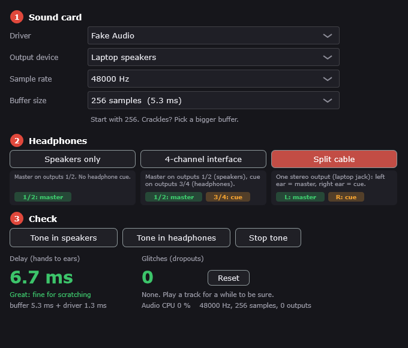
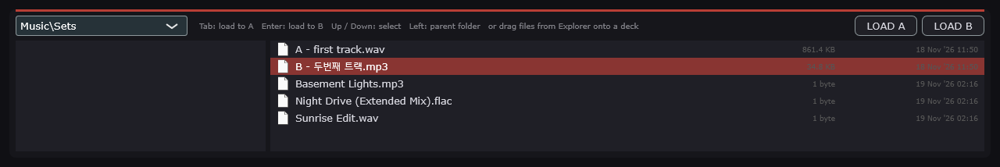
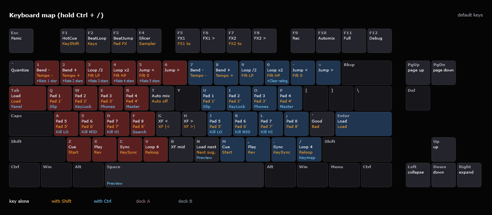
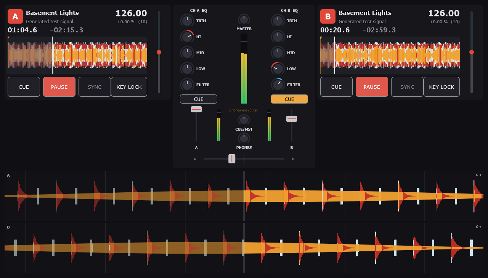
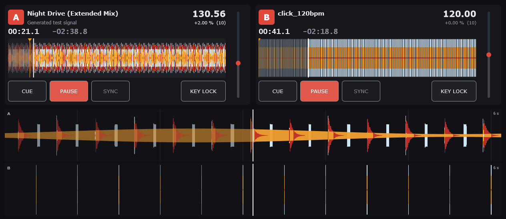
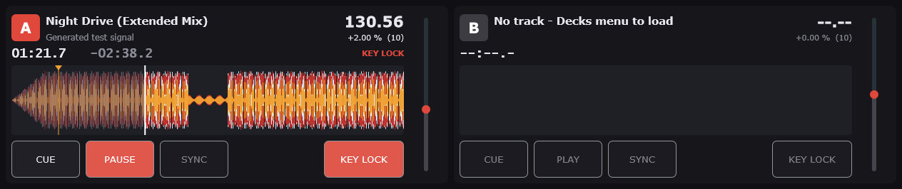

# Devil-DJ Dev Log

One entry per finished task, newest first. Keep each entry to a few lines: what changed, numbers measured, anything surprising.

Template:

```
## YYYY-MM-DD · P0-00 Task title
- What changed:
- Tests / measurements:
- Notes / follow-ups:
```

## 2026-11-20 · P2-23 History
- What changed: `library/HistoryRepository` - each app run's history is a session: a History playlist named by its date and time ("2026-11-20 21:13", created with the first play, so a run with nothing played leaves none), shown under History in the browser. A play appends the track to it and writes a `history` row with the deck, the time and the track played just before it in the session (the transition, `previous_track_id`; the first of a session has none). Queries for the Track Matcher: every transition (oldest first), how often A -> B was played, what followed A (with counts). The browser's menu on a history session: "Export tracklist (text)..." - "01. 21:14  Artist - Title" per line (UTF-8; untagged tracks by file name). `app/PlayTracker`: a library track counts once it has been playing 60 s in all since it was loaded (pauses don't count, once per load; files outside the library don't count); the app checks the decks 4 times a second and writes each play through the library's writer thread.
- Tests (Done-when: history survives restart; transitions queryable): two sessions with plays written, the library closed and opened again: sessions newest first, every play in order with deck, time and previous track; the session's playlist holds the tracks in play order and is named "YYYY-MM-DD HH:MM"; transitions A->B, B->C, C->B and A->B again, counts (A->B twice), what followed A; recording into a plain playlist or a missing session fails; the tracklist lines and the exported file (BOM, name, numbered lines); exporting a plain playlist or a missing session fails. The play tracker: 59 s no, 60 s yes, once; pauses don't count; a reload counts again; decks separately; non-library files never.

## 2026-11-20 · P2-22 Key Sync and Key Shift
- What changed: `util/MusicalKey.h` gains transposing, Camelot numbers, harmonic compatibility (the same Camelot number, or one step round the wheel in the same mode), the key a deck is heard in (Key Shift with key lock; without it the tempo's pitch change, rounded to semitones: +6 % = +1) and `keySyncShift`: the smallest move (-6..+6, a tie goes down) that puts a deck on the master's Camelot number (its key or the relative), or - with Options > "Key Sync: compatible keys too" (setting `keySyncCompatible`) - on any key compatible with it. Key Sync (Shift+C / Shift+., reserved since P1-16) transposes the deck once to match the deck leading the clock (else the other deck) as that one is heard; key shift -1 / +1 semitone (Ctrl+1 / Ctrl+2, Ctrl+7 / Ctrl+8, next to pitch bend; KEYMAP.md). Both turn key lock on (a shift is only heard with it; the engine's Key Shift exists since P1-08). The deck header shows the key as heard, with the move: "Eb (+2)", "8B (-1)", "D (+1)" for +6 % without key lock. `DeckState` gains keyShift.
- Tests (Done-when: transposed key shows in the deck header; test with generated chords): the generated C major and A minor chord loops played through a deck with key lock and a shift (+3, -2, +5; A minor -1), rendered offline and run through the P2-15 key detection: Eb, Bb, F, G# minor as expected; key lock at +6 % keeps C; +12.25 % without key lock comes out as D. Key Sync for every pair of the 24 keys lands on the master's Camelot number within +-6 semitones; examples (C vs F#m: -3 to A major; G vs C: +5, with compatible keys 0); compatibility; tempo to semitones. The header text through key lock, shifts both ways, Camelot and the tempo without key lock.
- Note: Key Sync is a one-time transposition (pressed again it matches again); following the master when its key changes later can come with the master / sync work if wanted.

## 2026-11-20 · P2-21 Beat Jump
- What changed: engine `BeatJump{deck, beats}` jumps exactly that many grid beats (variable-tempo grids count their own beats), so the phase is kept; with quantize on and the deck playing it waits for the next grid point (the P2-20 queue) and lands there + the beats, and a jump pressed while one waits adds to it (4 + 4 = 8); clamped to the track; no beatgrid = no jump. `JumpBy{deck, seconds}`: the fine 5 ms jump, at once. Each deck has a jump size (1/8, 1/4, 1/2, 1, 2, 4, 8, 16, 32, 64, 128 beats; 4 to start). Keys (KEYMAP.md): jump back / forward 5 / 6 and - / = (already reserved); fine 5 ms back / forward Ctrl+5 / Ctrl+6 and Ctrl+- / Ctrl+= (held: repeats); size larger / smaller Shift+6 / Ctrl+Shift+6 and Shift+= / Ctrl+Shift+= (Ctrl+Shift+5 is the 5-star rating, so the size went on 6 / =). The deck has jump buttons (back, the size - tap for the list of sizes - and forward) for mouse and touch. Moving a loop with the jump waits for loops (P3-03).
- Tests (Done-when: unit tests; keyboard bindings in KEYMAP): every size back and forward from inside a beat: exactly that many beats (to 1e-6 samples); across a tempo change in the grid; playing with quantize: on the next beat, two presses added up, +8 beats + the overshoot within 1 sample, the beat fraction kept; quantize off: at once; the track's start and end; no grid; the 5 ms jump (240 samples at 48 kHz, twice back). The default keys for all of it, and the keymap still has no conflicts.

## 2026-11-20 · P2-20 Quantize
- What changed: global quantize on / off (the ` key, Options > Quantize, settings `quantize` and `quantizeEighths`) and its resolution (1/8, 1/4, 1/2, 1 beat); the decks show Q (or Q 1/4 ...) while it is on. Engine (`SetQuantize`; `Play` / `Seek` can also be quantized one at a time): each deck has a queue of up to 16 actions that wait for their grid point, and the deck's render is split at the exact sample one falls due. Play from pause starts on the master clock's next grid point (when another deck leads; with nothing playing it starts at once); a cue set while paused snaps the cue and the playhead to the nearest grid point; a jump (seek) while playing happens as the playhead crosses its next grid point and lands on a grid point plus the overshoot, so the phase carries on to the sub-sample (a seek while paused just snaps). Pause (or play / pause again) calls a waiting play off; a new track clears the queue. Hot cues, loop in and beat jump don't exist yet: they use this queue in P2-21 and Phase 3.
- Tests (Done-when: engine test: triggered actions land on beat +-1 sample): quantized play at 1, 1/2, 1/4 and 1/8 beat, pressed at three places in a beat: the deck starts within 1 sample of the master's next grid point, never before it; while waiting it shows one queued action. A jump at rate 1 and at +3.7 % (crossings between samples), at 1 and 1/4 beat: it happens in the block that reaches the grid point, never before, lands within 1 sample of beat 40 + the overshoot, and the beat fraction is the one it would have had without the jump (within 1 sample). Cue snap (1.234 s -> beat 2 at 1/4 beat; off: exact), a quantized seek while paused, play immediate with quantize off or nothing leading, pause / toggle calling a waiting play off, the resolution snapping.

## 2026-11-20 · P2-19 Beat Sync
- What changed: SYNC on each deck (button, C / "." keys - already in KEYMAP.md; command `SetSync`). Each block, right after the master clock advances and before the decks render, every synced deck that doesn't lead: matches the master's tempo as heard, half / double aware (a 64 BPM track follows 128 at its own tempo, on every second beat; the fader range widens if the match needs it, e.g. 100 -> 128 BPM = +28 % on the 50 % range); and its phase: when sync starts (SYNC pressed, or play on a synced deck) and it is more than 2 ms off, one jump into phase (with the deck's 2 ms fade); after that a proportional rate nudge, at most +-0.5 %, aiming to close the error in 50 ms (`Deck::setRateCorrection`). Sync lock: a synced follower's tempo fader (and nudge / reset) sets the leader's tempo so the follower gets what was asked for - all synced decks move together; the leader's fader moves the followers. The clock's Auto mode now prefers a playing synced deck as the leader, else any playing deck with a grid (a synced deck needs someone to follow). The deck shows MASTER on the leader; the status overlay shows SYNC and the phase error in ms.
- About "converges < 1 beat" (PLAN): at the +-0.5 % limit only errors up to ~2 ms can close within a beat, so anything larger is snapped when sync starts; the nudge then only handles small errors and drift: 1.5 ms -> under 0.05 ms within one beat at 128 BPM.
- Tests (Done-when: two click tracks at 124 and 128 BPM, synced, stay within 1 ms for 10 minutes, offline render): deck A (128) on the master, deck B (124) alone on the headphones, B started mid-beat with SYNC: over 10 minutes all 1,279 beats within 0.021 ms (one sample at 48 kHz, the detector's resolution), B at exactly +3.226 %; Debug renders 2 minutes (ctest's limit). Also: 64 BPM under a 128 BPM master (within 1 ms, tempo unchanged); 1.5 ms off -> nudged under 0.05 ms in one beat; 30 ms off at sync -> one jump, then under 0.05 ms; sync lock both ways (follower +5 % -> the master at 124 x 1.05; master -2 % -> follower follows; still within 1 ms); sync off keeps the tempo and stops correcting; the range widening.
- Notes: with key lock the stretcher delays the audio a little against the playhead (P2-14 note); both decks with key lock on stay aligned with each other, one with and one without may be a few ms apart - not measured yet.

## 2026-11-20 · P2-18 MasterClock
- What changed: `engine/MasterClock` - the master BPM and beat (double beats), advanced once per render chunk on the audio thread before the decks render; real-time safe. Source: Auto (the deck that leads while it plays, else the first playing synced deck with a grid), one chosen deck, or the internal tempo. A deck that takes over gives the clock its phase and keeps the clock's bar count (its grid beat plus the nearest whole bars); with no deck leading the clock runs on from where it was at the internal tempo, which takes over the last leading deck's tempo - so the beat never jumps. `beatAt(sample)` / `sampleAt(beat)` on the engine's new absolute sample clock, for the scheduler. Engine: commands `SetClockSource` (mode, deck) and `SetInternalTempo` (20-300 BPM), each deck's beat and heard BPM (grid BPM x tempo) passed in at the block start; `EngineState` gains sampleClock, masterBpm, masterBeat, masterSource, clockMode, internalBpm; `engine.masterClock()` for audio-thread code. The status overlay (F12) shows the clock: BPM, who leads, bar and beat. Until the sync buttons (P2-19) every deck counts as synced.
- Tests (Done-when: unit tests for phase continuity across tempo changes): 10 minutes of random block sizes (1-2,048 samples) with 100+ random internal tempo changes (60-200 BPM): every block starts exactly where the last ended (largest jump 0), the beat equals the integral of the tempo to 1e-7 beats after ~1,000 beats, the sample clock exact. A leading deck: the clock takes its phase and the nearest whole bars (within 2 beats of where it was), follows its beat exactly through a +6 % tempo change with no jump between blocks; the deck stops -> the clock runs on from the same beat at the deck's tempo; it starts again -> leads again, bars kept. Who leads: Auto stays with the leading deck, then the first other one; no grid, not synced or a nonsense tempo can't lead; a chosen deck only while it plays; Internal. In the engine: a playing deck with a 124 BPM grid leads (tempo, phase), +6 % follows, the source commands, the sample clock.

## 2026-11-20 · P2-17 Analysis cache
- What changed: `analysis/WaveformCache` - the `<content hash>.wfm` file of ARCHITECTURE §8 in %LOCALAPPDATA%\Devil-DJ\cache: the 3-band detail (150 points per second) and the overview as 8-bit sqrt-scaled levels (~0.9 KB per second of audio, a 5-minute track ~270 KB), written through a temporary file and a rename; version, size and header checked on read. The analysis service writes one for every track it analyzes (from the full-rate audio it decodes anyway; only for plain hash names). The track loader hashes the file first, reads its cache and hands the waveform to the decks at once (`onWaveformPreview`) - the zoomed waveform and the overview show it from the start, with the title "(loading)", until the decoded track is on the deck; the loaded track then uses the cached waveform instead of building it (re-labelled for the deck's rate: 44.1 and 48 kHz both give exactly 150 points per second). With no cache, or one that doesn't fit the decoded length, the loader builds the waveform and writes the cache.
- Tests (Done-when: loading an analyzed track shows its waveform in < 100 ms): second load of the 10-minute MP3 (Release): its waveform after 3.5 ms, the audio decoded after 845 ms; Debug (a 5 s MP3, ctest's limit): 3 ms; the delivered track's waveform is the cached one; the first load (no cache) shows no preview and writes the cache. Cache file: round trip within the 8-bit step, exact size, a 10-minute file read in 7 ms (Release) / 11 ms (Debug); wrong magic, other version, cut short, empty, missing -> nothing. Re-labelling 44.1 -> 48 / 22.05 / 88.2 / 96 / 192 kHz, refused for 44 kHz. The analysis service writes a cache per track at the file's rate (and none for odd hash names). The views draw the preview and drop it when the track reaches the deck.

## 2026-11-20 · P2-16 Loudness
- What changed: `analysis/Loudness` - our own ITU-R BS.1770-4 integrated loudness: K-weighting (the stage-1 high shelf and stage-2 high pass, worked out for any sample rate from the analog design; at 48 kHz they equal the coefficients printed in the standard), mean squares per 100 ms, 400 ms blocks with 75 % overlap, absolute gate -70 LUFS, relative gate -10 LU; left / right weight 1. `AnalysisService::loudnessAnalyzer` measures the full-rate stereo (not the 22.05 kHz mono the other analyzers use; a mono file counts as it plays, on both channels) and writes tracks.loudness_lufs; analysis version 5. Auto Gain: when a library track loads, its deck's trim is set to target - loudness (within the trim's +-12 dB); a track loaded before it was analyzed gets its trim when the result comes in, but only while the deck is stopped and nobody has moved the trim. Options > Auto Gain: on / off and the target (-8, -10, -12, -14 LUFS; settings `autoGain`, `autoGainTarget`). The trim is worked out at load from the stored loudness, so changing the target needs no new analysis (auto_gain_db stays empty).
- Tests (Done-when: test vectors - generated sine at known level - within 0.1 LU): the generated 1 kHz stereo sines at -20 and -6 dBFS; sines made in the test at 44.1 / 48 / 96 kHz and -10 / -23 / -33 dBFS, stereo and mono (3 dB less), all within 0.1 LU; the K-weighting coefficients at 48 kHz equal the standard's to 1e-9; the gates (-36 / -23 / -36 dBFS -> -23: the quiet parts gated out; -26 / -20 halves average; silence and -75 dBFS left out; silence, only under -70 and under 400 ms give no loudness); bass counts less and the top more than 1 kHz; Auto Gain arithmetic and clamping; the analyzer.
- Open: the default target (-10 LUFS for now) is meant to be chosen by listening (PLAN). Loud modern club tracks (around -7 to -9 LUFS) come down 1-3 dB; older or quieter ones go up, up to the trim's +12 dB, which can push their peaks into the master limiter.

## 2026-11-20 · P2-13 follow-up: beat tracker v2 (live recordings, octave case)
- Why: the owner's eval set (34 tracks with a BPM tag in the music folder; the other ~1,700 have none or a "0") gave 23 of 34 within +-0.5 BPM (67.6 %, target 90 %), weakest on loose live recordings, plus one half-tempo result.
- What changed (`analysis/BeatTracker`): on live tracks the constant fit kept only a cluster of the beats (e.g. 41 of ~380), because it judged every beat against one straight line while the band drifts by whole beats over a song. Now: the constant fit's outlier gate tightens pass by pass; the beats are split into straight pieces; a track where most beats sit in pieces at one exact tempo is steady (the odd pieces are slips of the beat chain), and its constant grid is refitted on the beats in phase with them (e.g. a 128 BPM track that came out 127.55 is now exactly 128.00); a track that isn't steady and whose constant grid misses most beats is followed again with a looser beat chain and gets a tempo-following grid (up to 16 anchors, one per tempo change) when that keeps clearly more beats on the grid; its BPM is the average. The tempogram also counts half the beat lag when choosing its peak (a steady drum loop with eighth-note hi-hats read as 2/3 of its tempo). Range 70-200 BPM (was 180). Analysis version 4, so every track is analyzed again once (locked grids stay). The eval report gained diagnostics columns (beats used, drift, constant-grid hits, following-grid hits, steady share, anchors) and counts the files it skipped.
- Results on the eval set: 25 of 34 within +-0.5 BPM (73.5 %, was 67.6 %). Beats within 25 ms of the grid on the live recordings, before -> after: 9 % -> 69 %, 25 % -> 64 %, 9 % -> 60 %, 15 % -> 76 %, 12 % -> 43 %, 14 % -> 49 %; steady tracks unchanged or better. Of the 9 still outside +-0.5: 4 come out at an exact whole tempo 1-2 BPM from the tag (132.00 / 130, 128.00 / 130, 138.00 / 137, 85.00 / 84) - most likely rounded or guessed tags, to check by ear with the metronome; 3 are loose live recordings (off by 1-6 BPM against the tag, which is itself only an average for such a track); 1 is 0.65 off; 1 is the half-tempo track.
- The half-tempo track (tag 179, found 90): left alone on purpose. Two ways of doubling slow tempos were tried (doubling when the music hits as hard halfway between the beats; choosing among the tempogram's peaks by how well their beats sit on the onsets): neither tells a 90 BPM ballad from a 180 BPM song, and the second turned a correct 117 into 78. Such a track is one click to fix: GRID > BPM x2.
- Tests: a 2-minute synthetic live band (kick / snare / eighth hi-hats, the tempo wandering about +-3 % over tens of seconds, hits off by a human 6 ms): variable grid, 11 anchors, 100 % of the beats within 25 ms (a constant grid at the same average: 12 %), average BPM within 0.5; steady programmed drums at 124: one constant grid, BPM within 0.02, 99 % of the beats within 5 ms; the multi-anchor JSON. All P2-13 click-track tests unchanged (BPM error < 0.002, first beat < 0.2 ms); the 10-minute metronome test still 0.125 ms.

## 2026-11-20 · P2-15 Key detection (our own)
- What changed: `analysis/KeyDetector` - our own chromagram key finder: 8192-point FFT every 2048 samples (22.05 kHz mono, Hann), spectral peaks from C2 to C7 refined with a parabola through the log magnitudes; tuning estimated as the weighted circular mean of the peaks' deviation from equal temperament (A = 440) and taken out; peaks into 36 bins per octave folded to 12 pitch classes; each frame's chroma normalized and weighted by its loudness (silent frames skipped); Pearson correlation with the Krumhansl-Kessler major / minor profiles at all 12 roots; key + confidence (fit x lead over the runner-up) + tuning. `AnalysisService::keyAnalyzer` writes musical_key / key_confidence; analysis version 3, so every track is analyzed again once (a track with no key found keeps its tag key). `util/MusicalKey.h`: musical names, Camelot codes, relative / fifth relations. Display setting: Options > Show keys as > Musical / Camelot (setting `keyNotation`): the library's Key column (sorting by key follows the Camelot wheel when Camelot is on: 1A, 1B, 2A ...), the decks (the loaded track's key next to the BPM, updated when analysis finishes); the key filter and the smart-playlist key list show both ("F#m  11A").
- Tests (Done-when: all 24 generated chord loops detected correctly; eval-set accuracy reported): all 24 `keys/` loops exact (lowest confidence 0.67, smallest lead over the runner-up 0.115, tuning within 3 cents); A major and F# minor progressions in other voicings at 0, +35 and -40 cents: key exact, tuning within 5 cents; silence / too short: no key; white noise less confident than a chord loop; the analyzer sets key and confidence and leaves silence alone; names and Camelot for all 24 keys parse back through the tag parser, relative / fifth helpers; the table's Key column in both notations and the Camelot sort order; the deck shows its key; setting default. ctest 356/356 Debug, 350/350 Release, 0 warnings. Release app starts and closes cleanly. P2-14 CI passed.
- Eval set: the hidden test `DevilDJTests.exe "Key detection: the owner*"` with `DEVILDJ_EVAL_DIR` set reads known keys from `key.csv` ("file name,key" per line, "Am" / "8A" / ...) or the files' key tags, writes `eval-key-report.txt` (exact, relative / fifth, confidence, tuning per file) and checks >= 75 % exact and >= 90 % with relative / fifth. Not run yet: it needs the owner's tracks (the result goes here when it is).

## 2026-11-20 · P2-14 Beatgrid model + editing
- What changed: `util/Beatgrid` - up to 16 anchors (beat index, sample, BPM until the next anchor, which beat of the bar it is), a plain fixed-size value the audio thread can hold; mapping both ways (before the first / after the last anchor at their tempo), bar position (4/4), nearest beat; edits: shift by samples / ms, downbeat one beat earlier / later (the bar phase turns, the beats stay), set downbeat here (the nearest beat moves exactly to the position and becomes beat 1), BPM x2 / /2 (the first beat stays), rescale to another sample rate; `anchors_json` read / write (the analysis' and the importers' format); `TapTempo` (least squares over the last 16 taps, a 2 s pause starts over). Engine: `SetBeatgrid` / `SetMetronome` commands; each deck holds its grid (cleared when a new track comes, until the app sends that track's grid); after each chunk the deck's beats crossed between the playhead's old and new position start a 15 ms click on the cue bus at the exact sample (2 kHz and louder on downbeats, 1 kHz otherwise), so it follows tempo changes and only clicks while playing forward; the deck state reports grid, lock, beat, bar beat, grid BPM, metronome. The engine's command queue moved to the heap (a command is ~0.5 KB with a grid in it: 1,024 of them overflowed a test's stack). `library/BeatgridRepository` (get with the track's sample rate, set also writes tracks.bpm and bpm_locked so analysis leaves a locked grid alone). App: when a deck loads a library track, its grid is read at the file's rate and scaled to the deck buffer's rate; analysis results for a loaded track arrive on the deck too. Tools (each deck's GRID menu, TAP button, and Ctrl+Shift keys - KEYMAP.md: set downbeat Z/M, 1 ms earlier / later A,S / J,K (held: repeat), downbeat one beat earlier / later Q,W / U,I, BPM x2 / /2 E,R / O,P, tap X / ",", metronome C / ".", lock V / "/"): edits go to the deck at once and are saved at the file's rate; an edited (or tapped) grid is locked. Tap tempo takes the tempo fader out (the taps are in the playing track) and puts a beat at the playhead. The deck shows the grid's BPM (x tempo), BEAT n while playing, MET and GRID LOCK; the waveforms draw a line on every beat, red on downbeats (instead of second ticks).
- Tests (Done-when: grid edits persist; the metronome stays on the grid for 10 minutes on a 128 BPM click track): a 10-minute 128 BPM click track gridded by the beat tracker, played through the engine with the metronome on the headphone outputs: all 1,279 clicks within 0.125 ms of the track's own clicks, first and last the same (no drift) - Release; Debug plays 2 minutes (ctest's limit). At +6 % tempo 0.02 ms; downbeats louder; off = silence; a new track clears the grid. Edits persist: read at 44.1 kHz, scaled to 48 kHz, x2, /2, +10 ms, downbeat moved, locked, saved, library reopened -> the same grid (within the JSON's whole samples), locked, BPM and bpm_locked in the track. The model: constant and multi-anchor mapping, bar positions, every edit, rescaling, JSON round trip and 7 bad inputs, tap tempo (4 taps, fit, restart after a pause). Waveform: red line on the downbeats, grey on other beats, none without a grid. ctest 350/350 Debug, 344/344 Release, 0 warnings. Release app starts and closes cleanly.
- Notes: with key lock on, the stretcher delays the audio a little against the playhead, so the metronome may click slightly ahead of the beat (not measured yet; Sync / Quantize in P2-19 / P2-20 will need the same correction).

## 2026-11-20 · P2-13 Beat tracker v1
- What changed: `analysis/BeatTracker` (own code, from the plan's description) - onset envelope: 1024-point FFT (`analysis/Fft.h`, own radix-2) every 128 samples at 22.05 kHz (172 frames per second), spectral flux of log-compressed magnitudes (all bands, and < 200 Hz separately), local mean removed, unit variance; tempo: autocorrelation of the envelope, comb filter over the beat lag and its 2nd to 4th multiples, searched 70-180 BPM in 0.02 BPM steps, a flat prior inside 85-175 BPM falling off outside, then octave rules (the faster of two tempos that both fit 85-175 when its comb score is at least 90 %; a tempo outside the range halves / doubles into it); beats by dynamic programming (onset + best previous beat 0.5-2 periods back, penalty 400 x log(gap / period)^2), sub-frame positions by parabolic interpolation, leading / trailing beats in silence dropped; a constant-tempo grid by least squares on the beat times with outliers (> 15 % of a period) dropped over 3 passes - the BPM is the fit's period, so it is far finer than the tempogram step; downbeat: the bar phase of 4 whose beats have the strongest onsets (low band x2); drift: 16-beat windows refitted, variable tempo when one is > 1 % off. The flux marks an onset ~15.5 ms before the sound starts (a sound entering the edge of the centred window already raises the log flux): measured on all five click tracks and corrected. `beatgridJson`: one anchor at the first beat. Plugged into the analysis service as `beatAnalyzer`; `kAnalysisVersion` is now 2, so libraries analyzed by P2-12 get BPMs and grids at the next start (locked BPMs / grids stay).
- Tests (Done-when, generated click tracks: BPM error < 0.02 and first beat < 5 ms): 90 / 120 / 128 / 140 / 174 BPM and the padded 128 - BPM errors 0.0001-0.0017, first beat errors 0.05-0.13 ms, accented downbeat found, no drift. Also: an accent on the 3rd click -> first beat is beat 3 of the bar; 120 -> 126 BPM drift flagged variable; +-2 ms jitter at 128 not flagged, BPM within 0.05; 87 and 174 keep their tempo, 60 doubles to 120; silence, noise and 3 s of clicks give no grid; the JSON. Analysis with beats: 20 ten-minute MP3s analyzed in 19.8 s while two decks played with key lock, 0 xruns, peak callback load 9 %. ctest 341/341 Debug, 335/335 Release, 0 warnings. Release app: the version bump re-analyzed the 44 test tracks in ~4 s; the click tracks show 90.00 / 120.00 / 128.00 / 140.00 / 174.00.
- Owner check still to do (Done-when, eval set): put >= 50 tracks with known BPM in a folder, with a `bpm.csv` ("file name,bpm" per line) or correct BPM tags, then run `$env:DEVILDJ_EVAL_DIR = "D:\path\to\folder"; .\build\windows-x64\tests\DevilDJTests_artefacts\Release\DevilDJTests.exe "[.eval]"`. It writes `eval-bpm-report.txt` in that folder (per track: known, found, error, octave errors) and passes when >= 90 % are within +-0.5 BPM. The 15.5 ms onset correction is from clicks; real music's attacks may shift it a little - the report's first-beat column will show it.

## 2026-11-20 · P2-12 Analysis service
- What changed: `analysis/AnalysisService` - a queue of track ids (no repeats; `prioritize` puts one at the front, for a track just loaded on a deck), cores - 1 workers (at most 4) at the lowest thread priority (`util::lowestThreadPriority`; the decoder's and resampler's helper threads inherit it), per-track progress and overall counts (`status()`), pause, `waitUntilIdle`. Per track: the path from the library, the app's decoder (`engine::decodeTrack` behind a `Decoder` function - analysis stays free of the engine and JUCE), the mono 22.05 kHz signal (sinc resampler, a shorter kernel than playback), the analyzers, results written in batches (one transaction per up to 25 tracks or ~1 s) with `analysis_version` = `kAnalysisVersion` (1: exact duration and sample rate - BPM / grid / key / loudness analyzers plug in with P2-13..16); a failed decode stores `-version` so it isn't retried until the version changes; locked BPM / beatgrids are left alone; stopping drops the track in progress (it stays not analyzed and is picked up at the next start). In the app: the service starts with the library, queues every present track with an older version, imports (folders, playlists, other software's libraries) queue their new tracks, and the browser shows "Analyzing 12 of 500" while it works. The browser now refreshes at most ~2.5 times a second while changes stream in (one refresh of 50k ids takes ~30 ms).
- Tests (Done-when: 500 tracks analyze in the background while two decks play with no xruns): Release - 500 MP3s imported and analyzed (Media Foundation decode, resample) in ~2.5 s while two decks played with key lock on a fake sound card at 48 kHz / 256: 0 engine and 0 device xruns, no audio-thread allocation, peak callback load 10-12 %, the decks still playing (measured with the CPU at 2.0 GHz). Hidden `[.perf]` test: 20 ten-minute MP3s (200 minutes of audio, ~230 MB decoded per worker) in 5.6 s, 0 xruns, peak 23 %. Debug runs 100 tracks without key lock (Debug can't run two key-locked decks in real time even without analysis). Also: queue / repeats / failed track / version per result / exact duration / mono at 22.05 kHz / workers at the lowest priority / batched writes; locked BPM and grid kept while other results land; prioritize goes first; stopping mid-way keeps what finished and the next start does the rest. ctest 338/338 Debug, 332/332 Release, 0 warnings. Release app: at start "44 tracks to analyze", done 1.4 s later (the 3 missing files skipped), clean shutdown.

## 2026-11-20 · P2-11 Library backup
- What changed: `app/LibraryBackup` - a backup is a zip with `library.db` (a consistent copy made with SQLite `VACUUM INTO` as a job on the database's writer thread, so no write is half in it), `settings.xml` and `manifest.txt` (time, library version); written as `.partial` and renamed when complete. Automatic: at every start, if the newest automatic backup is older than 20 hours, `auto-YYYYMMDD-HHMMSS.zip` in `%APPDATA%\Devil-DJ\backups` on a low-priority thread, then only the newest 7 automatic ones are kept (hand-made ones are never deleted). Options menu: Back up library now... (choose where; default `backup-<time>.zip` in the backups folder), Restore library from a backup..., Open backups folder. Restore is two steps because the library is open: the zip is checked (it has a library, it opens, `PRAGMA integrity_check` is ok, its version isn't newer than this app's) and unpacked next to the live files as `*.restore`; Devil-DJ offers to quit; at the next start, before the settings or the library are read, the current files are kept as `*.before-restore`, the old WAL / SHM are deleted (they would corrupt the restored file) and the backup goes in; a message says it was restored. `Settings::defaultFile()` for that.
- Tests (Done-when: restore test): a library with 3 tracks, a playlist and a cue plus a setting; backed up (the zip's entries and manifest checked, no .partial left); then a track deleted, one added, the playlist renamed and the setting changed; restore staged, a stale WAL put next to the live file, the restore applied: the tracks, the playlist name and order, the cue and the setting are back, the stale WAL is gone, the previous files are kept. Refused without staging anything: not a zip, a zip without a library, a broken database, a library from a newer version. Automatic: due when none / older than 20 hours, not 11 hours after; pruning keeps the newest 7 automatic, never a hand-made one; runAutomatic makes `auto-20261120-120000.zip` with a library in it, and nothing an hour later. ctest 334/334 Debug, 328/328 Release, 0 warnings. Release app: the first start made `auto-20261120-022919.zip` in the backups folder, clean shutdown.

## 2026-11-20 · P2-10 Missing files
- What changed: `library/MissingFiles` - `scanForMissingFiles` checks every track's file and keeps `tracks.missing` up to date both ways (runs in the background at every start, quietly, and from Decks > Check for missing files); `relocateMissingFiles(folder)` indexes a folder and its subfolders by file name (ignoring case), takes the file with the same size, and when several match the one with the same content hash; a file that is already another library track isn't taken; the paths change in one transaction, the track ids don't, so cues, playlists, tags and ratings stay linked. Importing a folder that holds a missing track's file (same content) now relocates that track instead of calling the file a duplicate (`ImportResult::relocated`; "2 moved files found again"). In the browser: "Missing files" in the tree lists them (right-click: Check for missing files now, Relocate missing files (search a folder)...); missing tracks are drawn in red in every list; right-click a missing track -> Relocate (search a folder for it)...; loading one says "File not found ... (right-click > Relocate to find it)" and marks it missing. Decks menu: Check for missing files, Relocate missing files (search a folder)... Both run on the library worker thread (`LibraryTask`), the result in the status line ("Found 12 of 14 missing files").
- Tests (Done-when: moving a folder and relocating restores all links): 4 tracks in nested folders (one Korean) with a playlist order, a hot cue, a memory loop, a tag and a rating; the folder renamed / moved; the check finds 4 missing; relocate finds 4 of 4; same ids, new paths, not missing, playlist order, cues, tag and rating all intact; checking again changes nothing. Relocate rules: a renamed-in-case file, two same-name same-size look-alikes (the content decides), a same-name file of another size left alone, limiting to chosen tracks; importing the missing track's file relocates it, a real copy stays a duplicate; a file that came back is cleared by the next check. Browser: the Missing files view, rows marked, the load message, both menus. Older tests updated for the new tree row (and one now waits for the write its load triggers). ctest 331/331 Debug, 325/325 Release, 0 warnings. Release app: the start-up check ran (47 checked, 3 missing - test tracks whose temp files are gone), clean shutdown.

## 2026-11-20 · P2-09 Importers from other software
- What changed: Decks > Import library from other software (XML)..., or drop the .xml on the browser, or `--import=`. Two formats, read with our own code from their public structure: "DJ library XML" (the DJ_PLAYLISTS format other DJ software exports - the owner chose a neutral name over the brand name, see CLAUDE.md) and the iTunes / Apple Music "Library.xml" property list; the format is picked from the root element. `library/XmlReader`: a small XML reader (elements, attributes, text, named and numeric entities, comments, CDATA, declaration, DOCTYPE skipped; no external entities, no DTD processing, depth limit). `library/ForeignLibrary`: both files become one neutral description (tracks with title / artist / album / genre / comment / BPM / key / rating / colour / play count / date added / sample rate, cues and loops with pad, label and colour, tempo markers, a playlist tree), then `importForeignLibrary` imports the files that exist (the normal importer: tags, cover art, analysis queue), finds our track for each (by path, else the same content elsewhere), copies rating (0-255 or 0-100 scales -> stars; an iTunes "computed" album rating is ignored), colour, BPM (unless locked), key, play count (the higher), comment (only into an empty one) and the date added; adds the cues (hot cue / memory cue, hot / memory loop with its length, fade-in / out -> mix in / out; positions in samples at the file's sample rate) and a beatgrid from the tempo markers (`beatgrids.anchors_json`, beats counted between markers) only to tracks that have none, so importing again adds nothing; rebuilds the playlists (folders, order, a track listed twice, entries by id or by location) inside a new folder "Imported <format> <date>". iTunes: the library itself and the built-in Music / Movies / ... lists are skipped, folders are linked by their persistent ids, streams skipped. Missing files are skipped and listed in the log; the status line sums it up.
- Tests (Done-when: hand-written fixtures in `tests/data/fixtures/` import cues and playlists correctly): the XML reader (entities, CDATA, comments, DOCTYPE, BOM, 9 kinds of broken XML); file locations (localhost, ///, %-escapes, raw UTF-8, UNC); the DJ fixture parsed field by field (4 tracks, 6 position marks of 5 kinds, 2 tempo markers, the tree); imported into a real database with generated audio (3 tracks, 1 missing): metadata, all 6 cues with kind / pad / sample position / loop length / label / colour, the beatgrid JSON, the playlist tree in its folder with order and the missing track left out; importing again adds no tracks, cues or grids; the iTunes fixture parsed and imported (ratings, computed rating ignored, BPM, play count, comment entity, date, folder before / after its playlist). ctest 328/328 Debug, 322/322 Release, 0 warnings. Ran the Release app with `--import=` on the filled-in DJ fixture: 3 of 4 tracks, 6 cues, 1 beatgrid, 3 playlists, the missing file logged, clean shutdown.
- Notes: the beatgrid is stored for P2-14 (beatgrid model); nothing reads it yet. A second import of the same file makes a second playlist folder (the tracks, cues and grids aren't duplicated).

## 2026-11-20 · P2-08 Tags, ratings, colours
- What changed: on the selected track(s) in the browser - rating: Ctrl+Shift+1..5 / Ctrl+Shift+0 (the keymap had them since P1-16, now they do something), a click on a star in the Rating column (drawn as five fixed slots; the same star again clears), right-click -> Rating; colour: Devil-DJ's own palette of eight (`ui/TrackColours.h`: red, orange, yellow, green, aqua, blue, purple, pink + no colour; colours other programs wrote are kept as they are), a click on the colour cell or right-click -> Colour; tags: right-click -> Tags - each category as a submenu with its tags (ticked when every selected track has it; a click toggles), uncategorised tags, New tag... / New tag in <category>... (also tags the selection), New category..., Rename / delete. New Tags column (names, sorted, sortable). `TrackRepository::setRating` / `setColour` change one field (and notify). Writes go through the database writer in one transaction per edit; the table, the filter choices (colours by palette name) and smart playlists follow. Fixed on the way: a refresh after an edit kept only one of several selected tracks selected, so the next edit missed the others - it now keeps them all.
- Tests (Done-when: persisted and filterable): the repository setters (validation, change notes, other fields untouched); ratings on several tracks, the table shows them, the star a click hits, a simulated click on the third star rates 3 and again clears, the menu ticks the current rating, the rating filter finds them, and after closing and reopening the library they are still there and still filter; colours on several tracks, the palette menu with ticks, the colour filter, No colour, after a reopen; tags - a category, a tag made in it from the menu tagging the selection, ticks only when all selected have it, toggling on / off, the Tags column and sorting by it, rename tag / category (the filter list follows), the tag filter with one and two tags (all of them), after a reopen, deleting a tag and a category. ctest 322/322 Debug, 316/316 Release, 0 warnings. Release app starts and closes cleanly. Screenshots regenerated (stars, Tags column).

## 2026-11-20 · P2-07 Smart playlists
- What changed: `library/SmartRules` - rules of field (title, artist, album, genre, comment, tag, BPM, key, rating, colour, year, length, date added, last played, play count), operator (contains / doesn't / is / is not / starts with / more / less / between / in the last N days / not in the last / empty / not empty; each field offers only the ones that fit) and value(s), combined with all (AND) or any (OR). `toSql(rules, now)` gives an SQL condition on `tracks t` with its parameters in order: LIKE with % / _ / \ escaped, text equality ignoring case, NULL-safe "is not" / "doesn't contain" (an unknown key counts as "not Am", never played as "not in the last 7 days"), lengths in seconds -> the column's ms, whole numbers for keys / ratings / colours, days relative to now, tags by name through track_tags, no rules = the whole collection; an operator that doesn't fit its field is refused. Rules are stored as JSON in `playlists.rule_json` (own small reader for this format; unknown fields / operators fail instead of being dropped). In the browser: right-click Smart playlists -> New smart playlist... (starts with a BPM 120-128 rule), a smart playlist -> Edit rules..., Delete...; the editor dialog has the name, match all / any, rule rows (field, operator, one or two values, a key list for Key, "days" / "stars" / m:ss / #RRGGBB hints), + Add rule, - per row, and a live "37 tracks match" count; Save waits until every row is filled in. Showing a smart playlist runs its rules each time, so it follows new imports, edited tracks, tags and edited rules; the search box and filters work on top; no reordering or removing (its order isn't stored). Broken rule JSON shows an empty list with the reason.
- Tests: Done-when - rule -> SQL for every kind of field and operator (exact SQL and parameters), escaping, reversed ranges, all / any, no rules, refused combinations, and every operator the editor offers producing SQL; the SQL run against a real database (17 rule sets, including %-in-text, case, NULLs, ratings 0 = unrated, days, tags); JSON round trip (quotes, backslashes, Korean) and 8 kinds of bad JSON. Editor: values as typed (5:30, #E03030, 127,5) and back; rows / rules / count / Save; every field / operator pair set up and read back. Browser: created, listed under Smart playlists, shows its matches, a new matching track appears and an edited one leaves, edited rules apply at once, search on top ("0 of 1 tracks"), the editor's count, broken stored rules. A smart playlist without rules now shows the whole collection (the P2-04 tree test expected an empty one). ctest 318/318 Debug, 312/312 Release on mains power. Release app starts and closes cleanly. Screenshot `docs/images/p2-07-smart.png`.
- Notes: during this task the laptop ran on battery and also slept mid-run (one ctest run showed a 9,044 s "timeout" on the scroll test); on battery the P2-04 scroll test and a Debug sort check missed their bounds again. The Debug sort check now has a sanity bound (2 s) like the other Debug timings; the Release numbers are what count, measured on mains.

## 2026-11-19 · P2-06 Playlists
- What changed: in the browser, right-click the tree: Playlists / a folder -> New playlist, New folder, Import M3U / M3U8 playlist...; a folder -> Rename..., Delete... (with everything inside); a playlist -> Rename..., Export as M3U8..., Delete... (asks first; the tracks stay in the collection). New names default to a free "New playlist" / "New playlist 2". A new playlist is shown once it exists. Tracks: Ctrl / Shift + click selects several; drag them onto a playlist in the tree, or right-click -> Add to playlist (folders as submenus, or a new playlist with them); drag rows inside a playlist to reorder (a red line shows where; only in playlist order without a filter, where rows are positions); Delete (new action "Browser: remove from playlist") or right-click -> Remove from playlist (works sorted too: one occurrence per selected track); right-click also has Load to deck A / B and Show in Explorer. Decks still load the first dragged track (the drag now carries {path, trackIds}). `library/PlaylistFiles`: `writeM3u8` (UTF-8 without BOM, #EXTM3U, `#EXTINF:<seconds>,<Artist - Title>`, absolute paths, CRLF), `readM3u` (comments / blank lines skipped, #EXTINF kept, paths relative to the playlist, root-relative `\Music\...` on the playlist's drive, `file:///` URLs with %-escapes, BOM, LF or CRLF, old .m3u in the Windows code page), `exportPlaylist`, `importPlaylist` (named after the file, into a folder or the top level; files not in the library are imported first; a copy elsewhere maps to the library track by content; missing files reported). Playlist files come in through Decks > Import playlist (M3U / M3U8)..., the tree menu, dropping them on the browser, or `--import=`, on the import thread.
- Tests: Done-when round trip - a library playlist (4 entries, one track twice, a Korean folder and title, a comma in a file name) exported, the file checked (no BOM, CRLF, `Artist - Title`), read back (same files, order, titles), imported into an empty library (3 tracks added, the same playlist) and back into the first (nothing new, same playlist), exported again (same files). Reading other software's files (relative, root-relative, URL, BOM, LF, no last line end, ANSI code page); missing files and copies; import into a folder. Browser: create / folders / unique names / rename (trimmed) / delete (shown playlist -> collection, folder with contents); add several and twice; reorder to the top, the end and the middle with the moved rows still selected (a bug the test found: the selection was set before the new order was read and landed one row off); no reorder when sorted by another column; remove by position and by track while sorted; drag description, drop on a playlist item, headings refuse, a deck loads the first track; menus per item kind; export from the browser. ctest 310/310 Debug, 304/304 Release. Ran the Debug app with `--import="Test set.m3u8"` (two real files, one missing): playlist "Test set" with both tracks in order, the missing one logged, clean shutdown.
- Also fixed: the P2-01 test "readers on several threads during a stream of writes" failed once in Release (`reads > 0`): the 50 writes could finish before any reader thread had opened its connection (a bit slower since P2-05's reader settings). The test now waits until the readers are reading before it writes; 100 repeats pass.
- Notes: this PC was on battery during the last runs (CPU at 1.9 of 3.3 GHz): the P2-04 scroll test then averages 13 ms per frame with a 95th percentile of ~20 ms (over the 16.7 ms frame; 6 / 8 ms on mains), and the one-letter search over 50k tracks takes ~47 ms (34 ms on mains). On a throttled laptop the browser may drop frames while scrolling a huge list - worth checking on the owner's laptop on battery; if it does, the table's painting can be made cheaper.

## 2026-11-19 · P2-05 Search and filter
- What changed: the browser toolbar has a search box (Ctrl+F; typing filters at once; Enter or Esc gives the keys back to the decks) and FILTER, which shows a row above the table: BPM from / to, key, minimum rating, colour (the colours in use, named), genre (the genres in use), tag ("Category: tag"), CLEAR. The count reads "6 of 10 tracks" while filtering; the selected track stays selected when it is still in the list; the filters work on the collection and inside playlists, with the column sort on top. `ui::TrackFilter` + `TrackTableModel::setFilter`: one SQL query - search words become an FTS5 query of quoted prefixes (`"mid"* "dri"*`, every word required; quotes and FTS syntax can't break it), joined on `tracks_fts` (an `id IN (SELECT ...)` subquery first copied the matches into a temporary index: 61 ms for a combined filter, 14 ms as a join); BPM range, any of the keys / colours, rating at least, genre ignoring case, all of the tags. Reader connections now use memory-mapped reads, a 32 MB cache and in-memory sorting (a BPM range on 50k tracks went from 31 to 6 ms).
- Tests: FTS query building; each filter and all together on a small library (title / artist / album / comment, word starts only, every word, case, Korean, punctuation-only text = no filter, BPM inclusive and tracks without BPM excluded, keys, rating, colour, genre ignoring case, tags all-of, inside a playlist in playlist order, sorting kept, "of N" count); the browser's controls (choices from the library, filter row above the table, combos apply at once, CLEAR, setFilter sets the controls, selection kept, hidden in Folders). Done-when, 50,000 tracks sorted by title, Release, worst of 3: one title 1.8 ms, two words 6 ms, a comment 2.5 ms, no match 0.2 ms, BPM 120-130 (6,875 tracks) 6 ms, search + BPM + key + rating + genre 8 ms, a one-letter search matching all 50,000: 34 ms - that is the cost of sorting the whole collection by title (39 ms with no search at all). Debug is ~5x slower and only has a sanity bound. ctest 303/303 Debug, 297/297 Release, 0 warnings. Release app starts and closes cleanly. Screenshot `docs/images/p2-05-search.png`.
- Notes: the slowest case left is sorting everything by a text column (~35-40 ms for 50k here); an index on the sort columns (schema v2) would remove it if the laptop turns out slower - check on the owner's library at the Phase 2 gate.

## 2026-11-19 · P2-04 Browser UI
- What changed: `ui/LibraryBrowser` replaces the file browser as the bottom panel. Left: a tree - Collection, Playlists (folders and playlists, nested), Smart playlists, History (both empty until P2-07 / P2-23), Folders (the P1-18 file browser, for files outside the library) - and the selected track's cover art. Right: the tracks in a virtualized `juce::TableListBox` with columns #, colour, title, artist, album (hidden by default), BPM, key, time, rating, genre, date added, comment: click a header to sort (empty values last, ties in import / playlist order), drag to reorder, drag edges to resize, right-click to show / hide. `ui/TrackTableModel`: on a sort or source change it reads only the ordered list of track ids; rows are read a page of 200 at a time when first painted, the 32 most recent pages kept. The layout string (order, widths, hidden columns, sort) is saved in the `libraryColumns` setting and restored at start. Loading: Tab / Enter, LOAD A / LOAD B, double-click (deck A), or drag a row onto a deck (decks are now also drag targets for library rows; the main window is the drag container). Keys: Up / Down / Page Up / Page Down move, Left goes to the tree (Up / Down then switch views), Right back to the table. The library opens at start (`%APPDATA%\Devil-DJ\library.db`; if it can't, only Folders works and the status says why). Adding music: IMPORT, Decks > Add music folder to the library..., dropping folders / files from Explorer on the browser, or `--import="folder"` on the command line; it runs `library::importTracks` on a low-priority thread with progress and the result ("Added 44 tracks, 1 unreadable (0.1 s)") in the status line, cover art cached in `%LOCALAPPDATA%\Devil-DJ\cache\artwork`. The browser follows the database's change notifications (new tracks, deletions, new playlists) and keeps the selected track selected. Not in the plan but needed on laptop screens: the browser had room for only ~3 rows below the waveforms at 1400 x 900 with 125 % scaling, so BIGGER / SMALLER (new action "Browser: bigger / smaller", Ctrl+B, KEYMAP.md) gives it the waveforms' room while picking tracks.
- Tests: key names / times; sorting by title (ignoring case) and BPM both ways with empty values last; playlist order with a track twice; pages read on demand (one page for rows 0-199, the cache keeps 32); sorting 50,000 by title 37 ms Release; tree sections and nesting; keyboard moves through table and tree (folders skipped), Tab / Enter load, missing file reported; every view paints; refresh after writes (selection kept), new playlist in the tree, deleted track gone; column layout through a real settings file (order, width, hidden / shown, sort - and the rows sorted by it after restoring); a library row dropped on a deck loads; no database -> Folders only; regression: a long list started one row down (the table scrolled "row 1 into view" before it had a height). Scrolling 50,000 rows (400 frames of wheel scrolling + 200 frames flinging the scroll bar across the whole list + end / start), browser at 1416 x 420: Release mean 6.1-6.7 ms, 95th percentile 7.8-10.4 ms per frame (60 fps = 16.7 ms), 204 pages read. Debug draws ~25x slower, so the Debug run draws a tenth of the frames and only checks they all drew. ctest 298/298 Debug, 292/292 Release, 0 warnings. Ran the Debug app: imported the generated test signals with `--import` (44 tracks, the corrupt file reported), library kept after a restart. Screenshot `docs/images/p2-04-library.png` (made-up tracks).
- Notes: in the test screenshot the tree's deeper names are cut short (its layout runs on the message loop); check in the app once playlists can be made (P2-06).

## 2026-11-19 · P2-03 Repositories
- What changed: `TrackRepository` (add / get / findByPath / list / count / update / remove; every column of `tracks` as a typed `Track`; validates rating 0..5, key 0..23, colour; removing a track takes its cues, beatgrid, tags and playlist entries and keeps its history rows with the track cleared), `PlaylistRepository` (folders, playlists, smart and history kinds; create / get / children / all / update / remove with everything inside a folder; only folders can hold playlists and a folder can't move inside itself; track lists: set / add at a position / remove positions / move, the same track may appear twice, folders and smart playlists hold no tracks), `CueRepository` (hot cues, memory cues and loops, hot loops, mix in / out; a hot cue or hot loop replaces whatever is on its pad 0..15; loops need a length; `forTrack` gives pads first), `TagRepository` (categories and tags with unique names ignoring case, assign / unassign, tags for a track, tracks with a tag; removing a category removes its tags). Change notifications: writes note `Change{table, id, removed}` on the connection; `Database` calls its listeners after each write job (before `writeAndWait` returns), drops changes from rolled-back transactions; `Connection::savepoint` for nested multi-statement writes. Connections refuse to run on the audio thread (Debug). The importer now adds tracks through `TrackRepository`, so imports notify too. ARCHITECTURE §6 describes it.
- Tests: CRUD per repository with the validation and error cases above, a full track round-trip of every column, NULL for empty values, cascades on track / playlist / category / tag deletion, pads replaced, playlist order operations and foreign-key refusals leaving lists unchanged, notifications (one per job with all its changes, delivered before writeAndWait returns, async writes, none for rolled-back or read-only jobs, removed listener), audio-thread refusal. ctest 288/288 Debug, 282/282 Release, 0 warnings.

## 2026-11-19 · P2-02 Track import
- What changed: `library/Importer` - `importTracks(db, filesOrFolders, options)` finds audio files (folders recursively, by the decoder's extensions, absolute paths, no repeats), skips paths already in the library (compared case-insensitively), hashes the rest (`library/ContentHash`: XXH3-64 of size + first 1 MB + last 1 MB, at most 2 MB read per file) and skips content already in the library or earlier in the same import (copies, moved / renamed files), reads tags on up to 4 reader threads (which inherit the caller's priority), and writes the new tracks in batches of 100 per transaction through the database writer, with analysis_version 0 and `queueAnalysis(trackId)` called for each (the hook the P2-12 analysis service will use). Cover art goes to `<cache>\<content_hash>.jpg/.png...` with an `analysis_artifacts` row of kind 'artwork' (no schema change). Progress callback per batch, cancel between batches; a result with found / added / already in library / duplicates / failed and the first 50 errors. `library/TagReader` gained `readTrackTags` (title, artist, album, genre, year, comment, BPM, key tag, duration, sample rate, bitrate, front cover) and `parseKeyTag` (note names incl. ♯ / ♭ and major / minor spellings, Camelot 8A / 8B, Open Key 1m / 1d -> key 0..23). Not in the UI yet (P2-04 browser).
- Tests: key tags (all 24 Camelot codes distinct, Camelot and Open Key agree, bad values rejected); artwork extension; hash reads size + first / last MB, not the middle; full tag set read back from a tagged MP3 with a Korean file name and a PNG cover; a text file named .mp3 isn't readable (TagLib opens anything by its extension - a file now counts only if TagLib finds a sample rate); folder scan (recursive, extension case, repeats, missing path reported); importer extensions = decoder extensions; import of a folder (5 added, 1 copy = duplicate, 1 broken = failed with its error, tags / key / BPM in the rows, cover file + artifact row, analysis queued for exactly the added ids); re-import, also with a path in other letter case, adds nothing; a renamed copy elsewhere is a duplicate; cancel after the first batch, then a second run adds the rest. ctest 280/280 Debug, 274/274 Release, 0 warnings.
- Done-when: 2,000 files (small 35 KB MP3s, in the normal test) import in 1.05 s Debug, re-import 0.18 s and adds nothing. Hidden test `[.perf]` with 2,000 full-size MP3s (4.1 MB each, 8.4 GB): 5.5 s Release, re-import 0.04 s. Both warm-cache (the files were just written); a cold first import of a real folder will be slower, bounded by reading ~2 MB per file from disk, still well under 60 s on an SSD. Check on the owner's music folder at the Phase 2 gate.
- Notes: TagLib prints "Could not find an MPEG frame" to stderr for broken files; harmless, silenced later if it shows up in the app log.

## 2026-11-19 · P2-01 Database layer
- What changed: `library/Connection` (one SQLite connection per thread; UTF-8 file names so non-ASCII user folders work; busy timeout; `prepare()` returns a cached prepared statement, reset and ready to bind; `Statement` bind / step / run / typed getters with NULL as `std::optional`; `transaction()` = BEGIN IMMEDIATE ... COMMIT, rolls back when the body fails; errors are returned, never thrown). `library/Migrations`: ordered SQL scripts, each applied in its own transaction together with `PRAGMA user_version`; schema v1 = ARCHITECTURE §7 plus the three triggers that keep `tracks_fts` in sync (§6); a file from a newer Devil-DJ is refused and left untouched. `library/Database`: opens / creates the file, WAL + synchronous NORMAL + foreign keys on, migrates, then runs every write as a job on its one writer thread in queue order (`write` returns at once, `writeAndWait` for workers / tests, `flush`); `openReader()` gives each reading thread its own read-only connection. Not wired into the app yet (P2-02 / P2-03 use it).
- Tests: empty file -> v1 with every table and trigger, WAL on; reopening and re-migrating change nothing; newer schema refused; FTS follows insert / update / delete; deleting a track cascades to cues, beatgrid and playlist entries, a cue for a missing track is rejected; statement cache reuses one statement for 50 inserts, UNIQUE and SQL errors reported; rollback; 100 writes run in order on one thread that isn't the caller's, nested `writeAndWait` doesn't deadlock, queued writes still run on close; a reader reads the last committed state in well under 500 ms while the writer holds a 1000-row transaction open, then sees all rows after commit, and can't write; 3 reader threads during 50 write transactions: no errors, counts never go backwards. The temp folders have Korean in their names. ctest 271/271 Debug, 265/265 Release, 0 warnings; the [db] tests 5/5 repeated.
- Notes: Phase 1 gate passed (owner, keyboard only) together with the owner's 60-minute soak (PASS).
- CI fix: the first CI run of P2-01 failed on a P1-20 test, not on the database: "Soak test: per-minute stats" ran the full engine with key lock for 161 simulated seconds and took 109 s in Debug here, over ctest's 120 s limit on the slower CI machine. The tests that only check stats, timing and the report now run one block per 0.1 s tick instead of real-time audio, and the key-lock test uses 40 s tracks: 109 / 74 / 51 s -> 6 / 35 / 3 s. Slowest Debug test is now 35 s.

## 2026-11-19 · P1-20 Soak test
- What changed: `app/SoakTest` (Options > Soak test: 60 min / 5 min / stop; needs tracks on decks A and B): key lock on both decks, tempo +3 % / -2 %, both playing; each deck jumps back before its end so it never stops (no loops until Phase 2); EQ low / mid / high (-12...+3 dB), filter and crossfader keep moving on slow sines at different speeds. Every minute it records engine xruns (blocks over budget), driver xruns, audio CPU mean / peak and process memory; at the end it resets the decks and mixer, writes `Documents\Devil-DJ\Soak\soak-<date>.txt` (verdict, device and buffer, CPU, memory, per-minute table; after a failure it suggests the next bigger buffer) and shows the summary. Silent mode mutes the master (everything still processed). Unattended runs from the command line: `--soak=MIN --soak-silent --soak-quit --soak-driver=NAME --soak-buffer=N --soak-tracks="a.mp3|b.mp3"`. F12 overlay: process memory (private / in RAM), block CPU now / peak next to the engine and device xrun counters, and the soak progress line (`util/ProcessStats`).
- Tests: needs both decks loaded; plays both with key lock and the tempos; silent mutes the master; EQ and filter move; 90 s tracks keep playing for 100 s (they jump back, never reach the end); per-minute stats including injected engine / driver xruns; finishes by itself, reports FAIL with the glitch count and a bigger-buffer suggestion, resets decks / tempo / EQ / master; a clean run passes and stopping early still reports; buffer suggestions; process memory. The engine's own block-time xruns are ignored in these tests (the engine runs flat out there; in Debug that produced false xruns in two cases when ctest ran them alone). ctest 262/262 Debug, 256/256 Release, 0 warnings; the soak tests 3/3 repeated.
- Runs on the dev PC (not the target laptop), real app, silent, both decks the 10-minute test MP3, 10 minutes each: Windows Audio / Realtek speakers, 48 kHz, 512 samples (10.7 ms, 21.3 ms hands-to-ears): PASS, 0 engine / 0 driver xruns, audio CPU mean 4.7 %, worst peak 14 % of the block time, memory 533 MB flat. Asking for 256 samples: the device refuses in shared Windows Audio and in Windows Audio (Low Latency Mode) ("Buffer size 256 isn't supported"); both runs again PASS at 512 (peak 20 %), memory flat (533 / 538 MB). So on this PC the smallest buffer available without Exclusive Mode / ASIO is 512, and it is safe; 256 would need Exclusive Mode (takes the sound card from other apps) or an ASIO driver, not tried without asking.
- Owner's 60-minute run (`soak-20261119-054629.txt`, started 04:46): Windows Audio (Low Latency Mode) / Realtek speakers, 48 kHz, 512 samples (10.7 ms, 21.3 ms output latency): PASS, 60.0 of 60 minutes, 0 engine / 0 driver xruns in every minute, audio CPU mean 4.8 %, worst peak 15 % of the block time, memory 245 MB after minute 1 and 246 MB at the end (flat). Same sound card and buffer as the dev-PC runs; the laptop itself is still unconfirmed (D4).

## 2026-11-19 · P1-19 Audio settings page
- What changed: Options > Audio settings is now a Devil-DJ page in three numbered steps instead of JUCE's generic device selector. (1) Sound card: driver (with a tooltip on Windows Audio vs Exclusive / Low Latency / ASIO), output device, sample rate, buffer size shown with its delay ("256 samples (5.3 ms)") and a hint ("Start with 256. Crackles? Pick a bigger buffer."). (2) Headphones: the three output layouts as cards (Speakers only / 4-channel interface / Split cable) with a one-line explanation and where each sound goes (1/2: master, 3/4: cue, L: master, R: cue); a warning if the 4-channel layout is chosen on a device with fewer outputs. (3) Check: tone in speakers / tone in headphones / stop, the delay hands-to-ears in big type with a rating (Great <= 12 ms: fine for scratching, Good <= 25 ms: fine for mixing, High: try a smaller buffer) and its parts (buffer + driver), a glitch (dropout) counter with Reset, audio CPU, the current format and output count. Changes apply immediately; the page notices changes made elsewhere (device unplugged) and re-reads; closing it stops a running tone. The page moved into `app_core` so it can be tested.
- Screenshot (rendered by the `[.screenshot]` test against a fake sound card): 
- Tests (fake two-driver, two-device sound card): helpers (buffer text, latency ratings); the page shows the open driver / device / rate / buffer and the current layout; choosing a buffer, a rate, another device and another driver really changes the device (lists refresh for the new driver); the layout cards set the layout and highlight; tones go to the cue and the master bus, stop, and stop when the page closes; glitch counter and reset; paints. ctest 257/257 Debug, 251/251 Release, 0 warnings. App smoke run OK.
- Manual test (owner; this is the Done-when): with your laptop and headphones, open Options > Audio settings without help from this note: pick the sound card, a 256 buffer, the headphone layout that matches your cable (laptop jack + splitter or headphones only: Split cable; audio interface with 4 outputs: 4-channel), press "Tone in speakers" and "Tone in headphones" and check each comes out where it should, then play a track for a few minutes and check Glitches stays at 0. Tell me anything that wasn't obvious.

## 2026-11-19 · P1-18 Simple file loading
- What changed: `ui/FileBrowserPanel` at the bottom of the window (temporary, until the Phase 2 library): places (Music, Downloads, Desktop, Documents, Home, every drive), a folder tree, and the selected folder's audio files (the decoder's supported extensions; other files hidden), LOAD A / LOAD B buttons, double-click = deck A; the last folder is remembered (`browserFolder` setting). Keys (through the P1-16 actions): Tab / Enter load the selected file to deck A / B (no selection: the file chooser as before), Up / Down / Page Up / Page Down move the selection, Left goes to the parent folder. Drag and drop from Windows Explorer: `ui/TrackDropTarget` (a `juce::FileDragAndDropTarget`) on each deck panel and its zoomed waveform; it accepts the first supported audio file of a drop, shows a "Drop to load deck A/B" highlight while hovering, and Explorer shows "no entry" for non-audio drags. All three paths end in `MainComponent::loadFile`. Layout: the window now opens at up to 1440 x 900 (never bigger than the screen; a saved size wins) and adapts to short windows: the mixer's knob rows shrink (42 -> 30 px, `MixerView::kMinimumHeight` 330) before the waveforms and browser are squeezed. Checked in the real app on this PC (about 1105 x 680 logical at 125 % scaling): before the change each waveform was 22 px tall, now ~67, browser 4 rows, faders ~70 px.
- Screenshot (off-screen render of the panel with a test folder; the app shows the same with a live folder tree): 
- Tests (Done-when: drag-and-drop and keyboard loading both work): the panel lists only the folder's audio files (.wav, .mp3 incl. a Korean file name; not .txt, not folders) and reports the folder for the setting; keyboard: nothing selected -> loadSelected false (the app opens the chooser), Down / Down selects, Tab -> deck A, Enter -> deck B, moves clamp at both ends, Left goes to the parent; drag and drop: interested only in drags containing audio, hover highlight on / off (also on drag-exit, which loads nothing), a drop of [notes.txt, track.mp3] loads the mp3, onto the deck panel and onto the waveform. ctest 252/252 Debug, 246/246 Release, 0 warnings. App run: browser fills from the Music folder with its folder tree.
- Manual test note (owner): (1) In the browser at the bottom, pick a folder in the tree, click a track (or Down), press Tab: it loads on deck A; Enter loads deck B. (2) Drag a music file from Windows Explorer onto deck B's panel or its waveform: the area lights up red, let go and it loads. (3) The browser remembers the folder next time.
- Notes / follow-ups: replaced by the library browser in Phase 2 (P2-xx). Dragging from the browser list onto a deck isn't supported (Tab / Enter / the buttons do that).

## 2026-11-19 · Fix: CI Debug "10-minute MP3 doesn't glitch" (one xrun on GitHub's runner)
- Found with the new CI failure annotations (`tools/ci_annotate_failures.py`): on the 2-4 core CI runner one audio block ran over budget while a 10-minute MP3 loaded. Cause: the loader runs at low priority, but its helper threads (SincResampler workers, the decoder's second-channel std::async) started at normal priority (Windows doesn't inherit thread priority), so they competed with everything; and the test's fake audio device ran its callback at normal priority, unlike real drivers.
- Fix: `util/ThreadPriority` (current / set / background / audio priority); the resampler workers and the decoder helper copy their caller's priority (the loader's: low), so loading never competes with audio or the UI; the fake test device runs its callback at audio (time-critical) priority like a real driver. Test: priority set / read back, a new thread does not inherit it, a copied one does. Pinned to 2 cores, the Debug glitch test passed 4/4 (callback load 7-13 %). ctest 249/249 Debug, 243/243 Release.

## 2026-11-19 · P1-17 Keymap overlay
- What changed: `ui/KeymapOverlay`: hold Ctrl+/ for a translucent US keyboard (function row, main block, navigation keys) drawn from the KeyboardController's live bindings: each key shows its action alone (white), with Shift (amber) and with Ctrl (blue; Ctrl+Shift goes there with a "+" if free); deck A keys tinted red, deck B blue; short keycap names (`commandShortName`). User rebinding (needed for the Done-when, before the keymap editor exists): `Documents\Devil-DJ\Keymaps\keymap.json` overrides on top of the KEYMAP.md defaults (`applyKeymapOverrides`: an entry moves its action, takes the chord from whatever had it, `""` unbinds; unknown actions / keys / contexts and bad JSON are reported and skipped, logged as warnings), loaded at start and with Options > Reload keymap; Options > Open keymap folder creates the folder and a `keymap.example.json`. Key names parse back from the overlay / KEYMAP names (`parseChord`: "Ctrl+Shift+N", "Shift+,", "PageUp"). KeyboardController gets `setBindings` / `currentBindings`. KEYMAP.md documents the file.
- Screenshot (off-screen render of the default map): 
- Tests: every default chord round-trips through its name; chord parsing (case, punctuation, errors); overrides move, take over, unbind and report three kinds of bad entry; the result has no conflicts; bad JSON is reported; the example file we write is valid; labels (Z = Cue / Shift Start / deck A, A = Pad 5 / Ctrl Kill LO, G global, Space alone unbound with Ctrl+Space preview); every bound key is on the drawn keyboard; Done-when: after a keymap.json moves deck A's cue to C, the overlay shows Cue on C and nothing on plain Z. ctest 248/248 Debug, 242/242 Release, 0 warnings. App smoke run OK.
- Manual test note (owner): hold Ctrl and / together: the keyboard map appears and goes away when you let go. To try a rebinding: Options > Open keymap folder, copy keymap.example.json to keymap.json, change "Z" to "C" in the first entry, save, Options > Reload keymap, hold Ctrl+/ again: Cue is now on C (and C cues deck A).
- Notes / follow-ups: the keymap editor (click a key, press the new one) comes with the settings UI; it will write the same keymap.json.

## 2026-11-18 · P1-16 Action system + keyboard controller v1
- What changed: `ui/Actions.h`: every bindable action from KEYMAP.md as a `CommandId` (deck actions x 4 decks + global / browser / Beat Maker / Code Beat actions; names, stable file keys, repeat flag) and `ActionDispatcher::perform(CommandId, ActionPhase)` with Press / Release / Repeat. `ui/KeyboardController`: PC scan codes (US names) + Shift / Ctrl / Alt -> action, per focus context (Main = performance view + browser; Beat Maker and Code Beat keys win while their panel has focus; a text field takes every key); press / release / hold semantics where a release always ends what its press started (even if Shift changed meanwhile), auto-repeat ignored except for repeating actions (tempo steps, list moves), `releaseAll()` when the main window loses focus. Default map = KEYMAP.md (all sections). `ui::PhysicalKeyHook`: a `WH_KEYBOARD` hook on the UI thread reads the hardware scan code before the IME / JUCE (the Korean IME turns the virtual key into VK_PROCESSKEY but leaves the scan code), and swallows keys it used; JUCE additionally detaches the IME while no text field has focus. MainComponent: the temporary key code is gone; handlers registered for cue, play, bend, tempo, filter sweep / reset, jump to start, EQ kills, key lock, headphone cue, load (Tab / Enter -> file chooser for A / B), crossfader glide / snap / centre, F11 full screen, F12 overlay, Esc panic. Docs: KEYMAP (what's implemented), ARCHITECTURE 9.
- Tests: the required conflict test (no two actions share key + modifiers in one context; the checker catches an injected duplicate and allows the same chord in another context); core default keys match KEYMAP.md (Space unbound); command names / unique file keys / deck mapping / repeat flags; press-release and swallowed repeats; repeating tempo; releases after Shift changes (both ways); modifier keys alone, unbound keys, text-field focus, focus loss releases all and ignores the late key-up; panel context priority (Beat Maker 1 = track 1, Z still cues); hook decoding of an IME-style message (VK_PROCESSKEY with Z's scan code -> Z), repeats, key-up, extended keys, no-scan-code messages; hook install / uninstall. Windows only calls keyboard hooks for real input, so key presses can't be simulated without typing into the foreground window; that part is the manual test below. ctest 243/243 Debug, 237/237 Release, 0 warnings. App smoke run: hook installed (no warning in the log).
- Manual test note (owner): (1) the usual keys still work: Z / X cue / play deck A, M / , deck B, 1 / 2 bend, Shift+1 / 2 tempo, G / H crossfader, Ctrl+A kill, F12 overlay, Tab / Enter load A / B, F11 full screen, Esc panic. (2) Switch Windows to Korean input (Win+Space or the 한/영 key) and try the same keys: they must behave exactly the same, with no Korean letters appearing anywhere. (3) Hold Shift+1 for a second: the tempo keeps stepping; hold 1: the bend holds and stops when you let go, even if you press or release Shift in between.
- Notes / follow-ups: keymap editor / JSON export and the "laptop compact" preset come with settings (Phase 3+); MIDI Learn will call the same dispatcher. Menu items still call MainComponent directly; they can move to CommandIds when the menu is rebuilt.

## 2026-11-18 · P1-15 Mixer view
- What changed: `ui/MixerView` between the two decks: per channel (A, B) TRIM, HI / MID / LOW, FILTER, CUE, channel fader with a pre-fader stereo meter, and an EQ / ISO header; centre: MASTER level with the master meter, CUE/MST (headphone mix), PHONES level and a "phones not routed" note when the output layout has no headphones; crossfader along the bottom. `ui/MixerControls`: `ValueControl` (knob, vertical fader, horizontal fader) with one set of gestures: drag (knobs vertical, 180 px for the whole range; faders follow the finger along their travel), Alt + drag = 1/10 speed, wheel 2 % per notch (Alt 0.2 %), double-click / double-tap resets; `LevelMeterView` (-48 ... +6 dB, green / amber / red, 0 dB line). Knob mappings: TRIM -12 ... +12 dB; EQ centre 0 dB, right +6, left -26 dB in EQ mode or a fade to a full kill in isolator mode; MASTER / PHONES centre 0 dB, right +6, left fades to silence; FILTER 0..1 (centre off). Every control shows the engine's value each frame (except while being moved), so keyboard kills / filter / crossfader and the Mixer menu stay in sync; the keyboard shortcuts now start from the engine's value too. Window layout: deck A | mixer | deck B on top, the two zoomed waveforms below.
- Screenshot (off-screen render by the `[.screenshot]` test; deck A HI +3 dB, deck B LOW -14 dB, filter right, fader 70 %, CUE on, crossfader towards A): 
- Tests: mappings at the ends / centre and round trips (EQ, isolator, trim, level; a kill shows fully left); control gestures (quarter-range drag = +0.25, Alt drag a tenth, wheel and Alt wheel, double-click reset, clamping, engine updates don't echo back; fader and crossfader follow their travel); every mixer control reaches the engine (trim, three EQ bands, filter, fader, CUE, crossfader, master, headphone mix and level; isolator kill); changes made elsewhere show on the controls. Touch: JUCE delivers touches as mouse events to the same handlers (each finger is its own input source, so two faders move at once). ctest 233/233 Debug, 227/227 Release, 0 warnings. App smoke run OK.
- Manual test note (owner): with a track on each deck, drag the knobs up / down (hold Alt for fine moves), use the mouse wheel on them, double-click to reset; drag the channel faders and the crossfader; click CUE. On the touchscreen, the same with fingers (two faders at once should work).
- Notes / follow-ups: the space under the deck panels is where the performance pads go (Phase 2/3). The EQ mode is still switched from the Mixer menu (the header shows EQ / ISO).

## 2026-11-18 · P1-14 Waveform data + zoomed view
- What changed: `analysis/WaveformBuilder` (run on the loader thread): 150 points/s (samplesPerPoint = round(rate / 150), 320 at 48 kHz) of peak + RMS for low (< 250 Hz), mid, high (> 2.5 kHz) on the mono sum, split with LR4 crossovers; 1,024-point overview per band plus full band. Replaces P1-13's simple overview (`WaveformOverview` removed); the deck panels' overviews now use the 3-band colours. `ui/WaveformView`: one zoomed view per deck under the deck panels, centred on the playhead, Devil-DJ colours (low deep red, mid amber, high pale ice; tallest band drawn first in each column so none hides another), played part dimmed, second ticks (no beat grid until Phase 2), cue marker, zoom 2 / 4 / 6 / 8 / 12 / 16 / 32 s with Ctrl + wheel (default 6 s). Repaints via VBlankAttachment; playhead extrapolated from the state's timestamp and rate (capped at 100 ms if the engine stalls) and moved back by the output latency (device buffer + driver latency, read once a second, plus the 1.5 ms limiter look-ahead) so the line is where the sound is heard. The P1-09 jog gestures moved here: drag = scratch / scrub with grab-and-move (1 px = the view's samples per pixel, so the waveform follows the hand), wheel = 5 ms nudge; the temporary jog strips are gone. Paint time and frame interval are measured per view and shown in the F12 overlay.
- Screenshot (off-screen render by the `[.screenshot]` test; deck A a generated 128 BPM track at +2 %, deck B a 120 BPM click track): 
- Tests / measurements: 60 Hz -> low band (0.8, mids < 0.05), 800 Hz -> mid, 8 kHz -> high (RMS 0.566, low < 0.001); 150 points/s, 1,024 overview points; click bursts land on their own point (within one point = 6.7 ms); a 10-minute track builds in 0.29 s (Release). View: extrapolation (+10 ms = +480 samples, x rate, minus latency, none while paused, capped when stalled, clamped to the track); zoom steps and clamping; drag 100 px left while paused scrubs exactly 100 px of track and stays paused; two wheel notches = +10 ms; paints with and without a track (playhead column white). Frame time, 2 decks, 1240 x 130 each, software renderer, Release on the dev PC: 2.0 ms per frame average, 3.5 ms worst after warm-up (60 fps budget 16.7 ms). ctest 229/229 Debug, 223/223 Release, 0 warnings. App smoke run OK.
- Owner checks still to do (Done-when): (1) alignment: load `tests\data\generated\clicks\click_120bpm.wav`, play it, and check each click sounds when its line crosses the white playhead (if they're consistently early or late, tell me roughly how much); (2) 60 fps on the laptop (D4): press F12 while both decks play; the "frame" lines should say ~60 fps with paint well under 16 ms.
- Notes / follow-ups: beat grid lines replace the second ticks in Phase 2. If the laptop struggles, the next step is caching the waveform strip as an image per zoom level and blitting it.

## 2026-11-18 · P1-13 Deck view
- What changed: `ui/DeckView` for decks A and B at the top of the main window: deck letter (lit while playing), title / artist (file name if there are no tags), elapsed / remaining time (monospaced; remaining turns red in the last 30 s while playing), BPM from the file's BPM tag times the tempo (`--.--` without a tag; analysed BPM comes in Phase 2) with tempo % and range, KEY LOCK indicator and toggle button, CUE (hold: press / release follow the button, so a finger works like a mouse), PLAY / PAUSE, SYNC (disabled with a tooltip until P2-19), vertical tempo slider (CDJ direction: down = faster; double-click resets; follows tempo changes from the keys), and the whole-track overview (peak + RMS per pixel, played part dimmed, cue marker, playhead; click or drag to seek). Repaints from VBlankAttachment and reads EngineState; controls send engine commands and don't take keyboard focus (deck keys keep working). New modules: `library/TagReader` (TagLib: title, artist, BPM tag; Unicode paths; never throws) and `analysis/WaveformOverview` (1,024 points of peak + RMS). The loader thread reads tags and builds the overview; TrackBuffer carries title, artist, tagBpm, overviewPeak / overviewRms.
- Screenshot (rendered off-screen by the `[.screenshot]` test from a generated 128 BPM test track: deck A playing at +2 % with key lock, deck B empty): 
- Tests: time / BPM / title formatting; overview x -> position (clamped when dragged off the ends); seek via the overview lands within one pixel; PLAY / PAUSE toggles and the label follows; CUE held while paused previews and returns to the cue point on release; key lock toggle; tempo slider sets +3 % when moved down, double-click value resets, external tempo changes move the slider; empty deck disables the transport and paints. TagReader: BPM parsing, untagged file, tagged copy with Korean / em-dash text and a Korean file name, missing file. Overview: values, every sample in exactly one point, short / empty input. ctest 223/223 Debug, 217/217 Release, 0 warnings. App smoke run OK.
- Manual test note (owner): Decks > Load track to deck A. The top-left panel shows the title and artist (or the file name), the times count while it plays, BPM shows if the file has a BPM tag. Click PLAY, hold CUE, click anywhere on the waveform strip to jump there, drag the tempo slider down to speed up (double-click it to reset), KEY LOCK toggles. On a touchscreen the same works with a finger.
- Notes / follow-ups: the overview is a simple peak/RMS strip; P1-14 adds the 3-band colours and the zoomed waveform (which takes over the jog strips). Track title also wants album art later (Phase 2 library).

## 2026-11-18 · P1-12 Headphone cue
- What changed: per-channel CUE (`ChannelParam::Cue`): the channel's pre-fader, pre-crossfader signal (after trim / EQ / filter) goes into the cue bus with a 20 ms ramp; several channels sum. Headphone mix (`ParamId::CueMix`, 0 = cue only, 0.5 = cue and master both at full level, 1 = master only; each side fades out over its half of the knob) and headphone level (`ParamId::HeadphoneLevel`, dB, max +6). The master taken into the headphones is after master gain and before the master limiter; the headphone signal then goes through its own limiter (same -0.3 dBFS ceiling), so both are delayed by the same 1.5 ms and the headphones can't clip. The cue bus feeds the P1-03 router unchanged: 4-channel = outputs 3/4, split = right ear (mono), stereo = not heard. The test tone is added after the headphone mix (straight onto its bus). Limiter rewritten to O(1) per sample (monotonic-queue running minimum + running sum re-added once per window); same output. EngineState: channel `cue`, `cueMix`, `headphoneLevelDb`, headphone peak L/R. App (temporary, KEYMAP keys): Ctrl+E / Ctrl+O toggle CUE on deck A / B; Mixer menu: headphone mix (5 positions) and level (0 / -6 / -12 / -18 dB); overlay shows CUE per channel, the headphone mix / level / peak, and "not routed" when the output layout has no headphones.
- Tests / measurements (Done-when: cue B while A plays to master, all three layouts; DC tracks A = 0.2, B = 0.1, crossfader full A): 4-channel: outputs 1/2 = 0.2 (A), 3/4 = 0.1 (B); mix centre 0.3, master-only 0.2, 0.75 -> 0.25; headphone -6 dB scales outputs 3/4 only. Split: left 0.2 (A), right 0.1 (B), centre 0.3, master-only 0.2. Stereo: 0.2 on both outputs, cueRouted false, cue on/off doesn't touch the master. Cue is pre-fader (B fader closed still cued) and after the EQ (low kill removes B's DC from the cue); two channels cued sum to 0.3. CUE switching ramps over 20 ms; headphones limited at +18 dB; no audio-thread allocation (Debug). ctest 215/215 Debug (twice), 209/209 Release, 0 warnings. App smoke run OK.
- Fix along the way: after P1-11 the Debug "10-minute MP3 doesn't glitch" test reported one over-budget block in full runs (two limiters scanning 72 samples per sample are slow unoptimised, while the loader's decode threads fill every core). The O(1) limiter fixed it.
- Manual test note (owner): this needs headphones on a separate output: Options > Audio settings > output layout "4-channel" (an audio interface with 4 outputs) or "Split" (one stereo output: master in the left ear, cue in the right). Play deck A to the master (crossfader on A: Shift+G), load deck B, press Ctrl+O: deck B is in the headphones only. Mixer > Headphone mix: "Cue + master" to hear both, "Master only" to hear the room mix. Ctrl+O again turns the cue off. F12 shows CUE and the headphone level.
- Notes / follow-ups: no cue / headphone controls on screen until the mixer view (P1-15). Sampler / Beat Maker / Code Beat channels join the cue bus when those channels exist.

## 2026-11-18 · P1-11 Crossfader and master
- What changed: `engine/Crossfader.h`: curves smooth (constant power, cos/sin, -3 dB each at the centre, default), linear (-6 dB), cut (full until 5 % from the far end, then a straight line to silence); per-channel assign A / THRU / B (defaults: deck A -> A, deck B -> B, C/D THRU); each channel's crossfader gain ramps over 20 ms. `dsp/Limiter`: stereo-linked brick-wall look-ahead limiter (1.5 ms look-ahead, 5 ms release, -0.3 dBFS ceiling): the per-sample gain requirement is min-held over look-ahead + 1 samples, released, then box-averaged over the look-ahead, which guarantees the output never exceeds the ceiling while the gain still moves as a 1.5 ms fade; final clamp for float rounding; latency 72 samples at 48 kHz. `dsp/LevelMeter`: peak per channel falling at 20 dB/s (so a 60 Hz UI sees every peak) and 300 ms RMS. Master section: master gain (dB, max +6, smoothed) -> limiter -> meter; the cue bus is not limited. ChannelStrip split into `processPreFader` / `applyFader`; channel meters are pre-fader (show trim/EQ). New params `Crossfader`, `CrossfaderCurve`, `MasterGain`, per-channel `CrossfaderAssign`. EngineState: channel peakL/R + rms and assign; crossfader, curve, master gain, master peak L/R + rms, limiter gain reduction (largest in the block), masterLatencySamples. App (temporary, KEYMAP keys): hold G / H to glide the crossfader (full travel in 1 s), Shift+G / Shift+H snap to the ends, B centre; Mixer menu: crossfader curve, assign deck A / B; overlay shows channel meters, crossfader and master meter / limiter.
- Note: with the default constant-power curve and the crossfader in the middle, decks A and B are each 3 dB quieter than before this task (that's what a constant-power centre is). Glide to one side (G or H) for full level, or set the curve to Cut.
- Tests / measurements: curve values at 0 / 0.5 / 1 for all three curves and both sides (smooth 0.7071 at the centre, constant power everywhere; linear 0.5; cut 1.0 and 0.5 at 2.5 % from the end), THRU = 1. Limiter on +12 dB signals (100 Hz sine at 3.98, noise with ~+12 dB peaks, isolated +12 dB clicks, a 55 Hz kick burst), in blocks of 256, 37 and 1: output peak 0.966051 = exactly the ceiling, never above. Material under the ceiling comes out bit-identical, 72 samples later. +12 dB sine: 12.3 dB reduction reported. Meter: peaks, RMS, 20 dB/s fall. Engine: crossfader full A / full B / THRU / cut, master -6 dB, pushed +18 dB into the limiter (9.78 dB reduction, output under the ceiling), crossfader slam ramps over 20 ms, no audio-thread allocation (Debug). Two engine tests updated for the -3 dB centre. ctest 209/209 Debug, 203/203 Release, 0 warnings (the Debug "10-minute MP3 doesn't glitch" timing test failed once in a full parallel run and passed 3/3 when repeated; it uses the real audio device, so it is load-sensitive). App smoke run OK.
- Manual test note (owner): play deck A and deck B. Hold H: the crossfader glides to B (A fades out), hold G to come back, B centres it, Shift+G / Shift+H snap. Mixer > Crossfader curve > Cut: both decks at full level until the very ends (scratch style). Mixer > Crossfader assign deck A > THRU: deck A ignores the crossfader. F12 shows the meters and the limiter; it should only show gain reduction when things are very loud.
- Notes / follow-ups: true-peak (4x oversampled) detection for "high quality" isn't done (sample-peak only). The UI's playhead/waveform alignment should add `masterLatencySamples` (1.5 ms) in P1-14. No master gain control in the UI yet (P1-15).

## 2026-11-18 · P1-10 Channel strip DSP
- What changed: `engine/ChannelStrip` (trim -> EQ/isolator -> filter -> fader, stereo, in place) on every deck channel. Trim +-12 dB. EQ mode: RBJ low shelf 70 Hz / peak 1 kHz / high shelf 13 kHz (Q 0.7), -26...+6 dB, coefficients follow the smoothed gains every 16 samples. Isolator: Linkwitz-Riley crossovers at 250 Hz / 2.5 kHz with the low band through the matching all-pass, per band -inf...+6 dB. Mode switch crossfades the two paths over 20 ms. Filter knob 0..1: centre +-2 % off, left = resonant LP 20 kHz -> 60 Hz, right = HP 20 Hz -> 10 kHz (exponential), TPT state-variable filters, separate LP and HP filters so crossing the centre crossfades; resonance 0..1 -> Q 0.71...11.3 (default 0.3, Q 1.6). Fader 0..1 with curves smooth (x^2, default), linear, sharp (1-(1-x)^3). Every parameter moves linearly over 20 ms. New header-only dsp blocks: `Biquad` (RBJ designs, double TDF2), `StateVariableFilter`, `LinearRamp`. Engine: `ParamId` / `ChannelParam` (flat ids per ARCHITECTURE 3.2) and `SetParam`; EngineState `channels` (trim, EQ dB, filter, resonance, fader, mode, curve). The audio callback now sets ScopedNoDenormals. App (temporary, KEYMAP keys): Ctrl+A/S/D and Ctrl+J/K/L toggle low/mid/high kill on A/B; hold Shift+3/4 (A) or Shift+9/0 (B) to sweep the filter to LP/HP, Shift+5 / Shift+- reset; Mixer menu: isolator mode; overlay shows each channel's EQ and filter.
- Deviation from the spec: the isolator crossovers are LR 8th order (48 dB/oct), not 4th. With LR4 a kill only takes 36-44 dB off at the band centre, so the Done-when (> 60 dB) can't be met; LR8 still sums flat. ARCHITECTURE 4 updated.
- Tests / measurements: isolator at 0 dB flat within 0.0005 dB from 20 Hz to 20 kHz (61 points). Kill at band centre: low -87.8 dB @70.7 Hz, mid -74.3 dB @791 Hz, high -76.8 dB @7.07 kHz, other bands untouched (< 0.0001 dB). Isolator +6 dB = +6.0. EQ mode flat exactly at 0 dB; low shelf -26 -> -25.4 dB @20 Hz; peak +6 -> 6.00 dB @1 kHz; kill in EQ mode = -26 dB. Filter: centre exactly transparent, knob 0 -> -61 dB @2 kHz, knob 1 -> -71 dB @200 Hz. Clicks (100 Hz tone, energy above 5 kHz): filter sweeps, resonance change and knob jumps peak at -50 dB re the tone; kills, boosts, trim jumps and mode switches at -46 dB; limit -40 dB, while a hard half-level step reads -15 dB (control test). 20 ms ramp timing checked. Engine SetParam path, state and no audio-thread allocation (Debug). ctest 202/202 Debug, 196/196 Release, 0 warnings. App smoke run OK.
- Manual test note (owner): load and play a track on deck A. Ctrl+A kills the bass (press again to bring it back), Ctrl+S the mids, Ctrl+D the highs - with Mixer > Isolator EQ on, a kill removes the band completely; off, it's a -26 dB cut. Hold Shift+3 to sweep the filter down (darker), Shift+4 up (thinner), Shift+5 resets. Nothing should click. F12 overlay shows the settings.
- Notes / follow-ups: no fader/trim controls in the UI yet (mixer view P1-15); faders default to full so playback level is unchanged. Crossfader, master, limiter, meters: P1-11. Cue bus will take the pre-fader signal (P1-12).

## 2026-11-18 · P1-09 Jog / scratch from mouse
- What changed: Deck jog API `scratchBegin/Move/End` and `nudge`. Each move carries the hand's travel since the previous one plus the UI time it was seen; the deck plays at the hand speed over the last 4 moves (timed on the UI clock, so block-boundary pickup and thread jitter don't matter), aims one move behind the hand and corrects drift over 100 ms, with a 5 ms smoother; rate clamped to +-8x. Hand stops -> settles onto it in ~20 ms. Key lock bypassed while scratching (crossfade out of / back into the stretcher). Playing: release ramps linearly to the tempo rate over 50 ms. Paused: drag scrubs audibly and stays paused on release. Wheel nudge: paused = silent position move; playing = played out as a <= 5 % rate offset. Hand clamped to track start/end. Engine commands `ScratchBegin`, `ScratchMove`, `ScratchEnd`, `Nudge` (times optional, audio clock fallback); DeckState `scratching`, and `rate` now reports the rate actually playing. App: temporary `ui::JogPad` strips at the bottom of the window (left A, right B; 1 px = 5 ms, wheel notch = 5 ms, grab-and-move direction), repainted from VBlankAttachment; overlay shows SCRATCH. KEYMAP note.
- Tests / measurements: 60 Hz moves with a steady hand: rate within 0.5 % (1.0 / -0.7 / 2.5x), steps < 3e-5 per 16 samples (no zipper). Moves picked up 0-5 ms late: rate 0.974-1.027, max step 0.0025. Moves only on 256-sample block boundaries: 0.972-1.021, max step 0.003. Hand stop settles < 10 ms off; release reaches 1.05 (tempo +5 %) within 50 ms with no jumps; scrub audible and silent after release; nudge +10 ms lands exactly with rate <= 1.05; edges clamp; no clicks on hand down / release; key lock returns after release; no audio-thread allocation (Debug). ctest 191/191 Debug, 185/185 Release, 0 warnings. App smoke run OK.
- Manual test note (owner): load a track on deck A (Decks menu), press X to play, then drag on the left strip at the bottom: slow drags slow the track down, fast ones speed it up, dragging right plays backwards; let go and it should glide back to normal speed with no click. Pause (X), drag again: you hear the scrub, and it stays paused. Mouse wheel on the strip nudges the beat slightly ahead/behind. Use the Release build for listening.
- Notes / follow-ups: P1-14 moves these gestures onto the zoomed waveform and can reuse the commands; the strip mapping (5 ms/px) may be tied to the waveform zoom then. No keyboard jog yet (KeyboardController, P1-16).

## 2026-11-18 · P1-08 Key lock (Master Tempo)
- What changed: `dsp/Stretcher` interface (prepare/reset, input/output latency, seek, process, transpose) and `SignalsmithStretcher` (Signalsmith Stretch 1.4.0 + Signalsmith Linear 0.6.6, both MIT, header-only via FetchContent as SYSTEM so their warnings don't hit /WX; default preset 120 ms block / 30 ms interval with split computation for even CPU per block; fixed random seed). Deck key lock: the main read head goes through the stretcher, fed `rate x block` input per block (per-sample rates so pitch-bend slew is followed); primed with `seek()` on play/jump so the next output is the playhead; reported position = input fed - inputLatency - outputLatency x rate, i.e. what's heard. Jump/start/stop/toggle fades unchanged (old position fades out via the resampler). Key Shift +-12 semitones (heard with key lock). Engine commands `SetKeyLock`, `SetKeyShift`; DeckState keyLock, transposeSemis. Deck::prepare takes the max block size (scratch buffers). App: Ctrl+W / Ctrl+I toggle key lock (KEYMAP), Decks menu items, overlay shows KEY LOCK.
- Tests / measurements: Done-when: 440 Hz at +10 % with key lock measures 440 Hz (level kept, playhead still 1.1x); same at -16/-6/+6/+16 %; without key lock 484 Hz. Key Shift +1 -> 466.7 Hz (466.2), -2 -> 392.8 Hz (392.0). Latency compensation: a click is heard when the deck reports it, 0.02 ms off at 0 % and 0.14 ms at +10 %. Toggle on/off while playing: max step 0.092 vs 0.098 limit. Seek with key lock plays the new material. No allocation on the audio thread (Debug, incl. seek, transpose, bend, toggles). CPU, 2 decks key lock +10 %, 256 @ 48 kHz, Release on the dev PC (16 threads): mean 3.1 %, p99 5.9 %, max ~7 % of the block budget (< 15 % target). ctest 180/180 Debug, 174/174 Release, 0 warnings.
- Notes / follow-ups: the plan wants the CPU number on the owner's laptop (D4): run `build\windows-x64\tests\DevilDJTests_artefacts\Release\DevilDJTests.exe "[.perf]"` there. Debug builds are ~65 % mean / >100 % p99 for 2 key-locked decks (unoptimised templates) — listen with Release builds; the CPU sanity test skips in Debug. Signalsmith licence text must go into THIRD_PARTY_NOTICES.txt and the About box (P8). Stretcher latency is ~150 ms of look-ahead, invisible because positions are compensated.

## 2026-11-18 · P1-07 Tempo and pitch
- What changed: `dsp/Resampler` for real-time variable-rate reading: 4-point cubic Hermite (default) and a 16-tap Kaiser-windowed sinc ("high quality"), whose tables are precomputed for rate buckets up to 2x so the low-pass narrows when playing faster; unity DC gain; outside the buffer = silence; no allocation in read(). Deck: rate = (1 + tempo %) x (1 + bend %); tempo fader with ranges +-6/10/16/50 % (default 10, other values snap, narrowing clamps), fine nudge steps, reset; pitch bend up to +-4 % that slews at 40 %/s (0 -> 4 % in 100 ms, back on release); tempo kept when a new track loads; tails of jump fades read at the same rate. Engine commands `SetTempo`, `NudgeTempo`, `SetTempoRange`, `ResetTempo`, `PitchBend`, `SetInterpolationQuality`; DeckState gets tempo, range, bend, rate. App (temporary, KEYMAP keys): 1/2 and 7/8 hold = bend down/up, Shift+1/2 and Shift+7/8 = tempo -/+ 0.1 % repeating; Decks menu: reset tempo A/B, tempo range; Options: high-quality resampling; overlay shows tempo/range/bend/rate.
- Tests / measurements: Done-when: 120 BPM click (44.1 kHz WAV decoded to 48 kHz) at +8 % measures 129.6 BPM (least-squares over 54 click onsets) with both Hermite and sinc, well within +-0.05. Also 128 BPM at -6/0/+3.3/+16 % within 0.05; playhead advances at the rate; range clamping/snapping, nudges, reset; bend ramps (0.43 % after one 512-sample block, 4 % within 0.2 s, back to 0); engine commands and state. Resampler: integer positions exact (Hermite), 1 kHz at 1.08x < 1e-3 error, sinc beats Hermite at 8 kHz, edges silent, unprepared sinc falls back to Hermite. ctest 171/171 Debug, 165/165 Release, 0 warnings.
- Notes / follow-ups: not tried by hand in the app this time (owner may be using the PC); keys are documented in the overlay. Key lock (tempo without pitch change) is P1-08. The tempo range menu sets both decks for now; per-deck ranges come with the deck view (P1-13). BPM display needs analysed BPM (P2-13).

## 2026-11-18 · Note: AppData differs between the owner's runs and Claude Code's
- Devil-DJ started by the owner (Explorer, shortcut) uses the real `%LOCALAPPDATA%\Devil-DJ\logs` and `%APPDATA%\Devil-DJ\settings.xml`. Copies started from Claude Code's tools run inside the packaged Claude app, so Windows redirects their AppData to `%LOCALAPPDATA%\Packages\Claude_pzs8sxrjxfjjc\LocalCache\...` — and that is also all Claude Code can read. This (not a logging bug) is why the owner's copies "didn't log" (P0-06 CI artifact, P1-06 Release). Owner-side logs must be read by the owner (Debug → Open log folder).
- Also: the Decks menu (load/unload deck A/B, status overlay) is now visible in every build; before, loading was only in the Debug menu, which Release hides.

## 2026-11-18 · P1-06 Deck transport
- What changed: `engine/Deck` (audio thread, no allocation): play, pause, toggle, seek (clamped), CDJ cue — paused: cue moves to the playhead and previews while held, release returns and pauses; preview + play keeps playing; playing: back to the cue and pause, release does nothing — end of track stops at the end. Position is a double in samples (linear interpolation, rate 1.0 until P1-07). Declicking: every start, stop and jump uses a 2 ms equal-power fade; a jump keeps the old read head as a fading tail (up to 4, so rapid jumps also fade). Engine: commands `Play`, `Pause`, `TogglePlay`, `CuePress`, `CueRelease`, `Seek` (names per ARCHITECTURE §3.2), `DeckState` in EngineState (loaded, playing, cue preview, at end, position, cue point, length, rate), decks summed to the master bus (mixer comes in P1-10/11). Loading onto a sounding deck now fades it out first and swaps when silent, so the old buffer is only released once nothing reads it; a track superseded while waiting is released unused. App: temporary deck keys from KEYMAP.md — Z cue / X play (deck A), M cue / , play (deck B), Shift+Z / Shift+M = track start — edge-triggered (no key repeat); overlay shows each deck's state, position / length and cue point.
- Tests / measurements: 17 deck tests — cue state machine (set + preview + return; back cue; preview → play; repeated back cue; cue at end), play/pause/toggle, end of track, seek clamping, exact sample read-out, empty deck, reset on load; clicks: opposite-phase seek, play/pause/cue on peaks, 8 jumps inside one fade, 2,000-step random transport fuzz — max sample step ≤ 1.5 × the 1 kHz sine's own slope everywhere; silent within 2 ms of pause. Mutation check: with the fade cut to 1 sample, 4 of the 5 click tests fail. 7 engine transport tests incl. fade-then-swap timing on load, superseded pending load, two decks summing, no allocation while playing/seeking/cueing (Debug). ctest 159/159 Debug, 153/153 Release, 0 warnings.
- Manual: Debug app, 10-min MP3 on deck A, X started playback (overlay PLAY). The rest of the key test was stopped because the owner was using the PC (synthetic keys went to the focused Chrome window) — owner to try Z/X by hand.
- Notes / follow-ups: deck keys use key codes, not scan codes yet (P1-16). The track's own end is not faded (as on CDJs). "positionSamples" isn't latency-compensated yet (needed once waveforms draw in P1-14).

## 2026-11-18 · P1-05 TrackLoader thread
- What changed: `engine/TrackLoader` — 2 low-priority pool threads decode (+ resample to the device rate, + xxHash3 content hash of size + first/last 1 MB), results go to the message thread (`callAsync`, or an injected poster in tests), where `engine/BufferRegistry` takes ownership (`shared_ptr<const TrackBuffer>`) and `LoadTrack{deck, raw pointer, id}` goes to the engine. The engine keeps a slot per deck (4); a replaced/unloaded buffer's id goes back through an SPSC queue (with a 16-entry retry list if it's full) and the 10 Hz housekeeping timer releases it from the registry, so the audio thread never touches a ref count or frees memory. A newer load on the same deck cancels the older one; destroying the loader cancels and waits; results arriving after that are ignored. Progress callbacks (decode 0–80 %, resample to 100 %, throttled to 5 % steps). `TrackBuffer::liveCount()` counter. EngineState gets per-deck slot state. App: Debug → Load track to deck A/B… (file picker) and Unload; the overlay shows deck status, load progress and live/registered buffers with MB. Generator v3 adds a 10-minute MP3.
- Tests / measurements: 7 loader tests (load → engine slot at 48 kHz, progress to 100 %, hash; replace A → old buffer freed after one engine block + housekeeping, counter back to the expected value; deck B independent; unload; supersede (10-min MP3 cancelled by a WAV); missing file error; destroy while loading; hash stable/different/empty). Glitch test: engine on a fake 48 kHz/256 device playing a tone while the 10-min MP3 loads → 0 blocks over budget, 0 RealtimeGuard violations, peak callback load 0.49 %; load took 1.8 s (Release) / 7.4 s (Debug). ctest 135/135 Debug, 129/129 Release, 0 warnings. Manual (Debug app, Realtek 48 kHz/512): loaded the 10-min MP3 into deck A (3.9 s, 220 MB), replaced it with a 5 s WAV → 1 buffer alive, 2 MB; 0 xruns, 0 RealtimeGuard violations.
- Notes / follow-ups: tracks are converted to the device rate at load; if the device rate changes later, loaded tracks need reloading (handle in P1-06/P1-19). Media Foundation MP3 decoding appends sample by sample — fine at 1.8 s for 10 min, could be optimised if P8-03 needs it. Python tool tests now take ~24 s because they generate the 10-min MP3 twice.

## 2026-11-18 · P1-04 Decoder abstraction
- What changed: `engine/TrackDecoder` → `decodeTrack(file, {targetSampleRate, cancel})` returns `util::Result<unique_ptr<TrackBuffer>>` (new `util/Result.h`). WAV/AIFF/FLAC/Ogg via JUCE readers; MP3/M4A (AAC, ALAC)/AAC via Windows Media Foundation `IMFSourceReader` (float PCM). Output float stereo (mono duplicated, > 2 channels → first two), converted to the device rate with the new `dsp/SincResampler` (Kaiser-windowed sinc, 32 zero crossings, β 9, cutoff 0.95 × lower Nyquist; polyphase table with 512 phases; SSE dot products; long signals split across up to 8 threads). Gapless: `engine/Mp3Gapless` reads the Xing/Info + LAME header (frames, encoder delay, padding) and trims MP3s exactly — Windows' MP3 decoder ignores it, which left audio 577 samples late plus 731 samples of tail; M4A is cut to the length the file declares (MF already skips AAC priming). New `dsp` static library (pure C++, no JUCE).
- Tests / measurements: resampler (44.1→48 k sine error < 1e-4, passband ±0.05 dB up to 19 kHz, 30 kHz alias at 96→48 k < −80 dB, DC unity, impulse timing ±1 sample; 60 s mono 44.1→48 k in 0.04 s Release on this 16-thread PC, 0.61 s before optimising). Decoder: WAV/AIFF/FLAC equal the 16-bit reference sample for sample; Ogg/MP3 duration within 1 ms, first/last audible sample on time, pitch and channel order right; ALAC (encoded by Media Foundation inside the test) lossless and AAC on time, both within 1 ms of the declared length; mono → both channels; 44.1→48 k and 48→44.1 k at load; all 43 generated audio files decode with the manifest duration ±1 ms; missing/unsupported/corrupt/empty/fake-MP3 files give errors; cancel works. MP3 header parser: real file, ID3v2 skip, junk, trim with decoders that drop 0/528/529 samples. Generator v2: `formats/` (ref 440 Hz L / 660 Hz R as WAV/AIFF/FLAC/Ogg/MP3, mono, 48 kHz, corrupt), int16 quantised in Python so all lossless formats hold identical samples. MP3/M4A tests skip where Media Foundation isn't installed. ctest 128/128 Debug, 122/122 Release, 0 warnings.
- Notes / follow-ups: the test ALAC/AAC encoder pads the last frame and the MP4 sink declares the padded length, so those files end 15 ms after the audio (silent); real files with exact edit lists should come out exact — check with the owner's eval tracks. MP3s without a LAME/Xing header (some old CBR encoders) aren't trimmed. iTunes `iTunSMPB` gapless tags aren't read yet.

## 2026-11-18 · P1-03 Output routing
- What changed: `engine/OutputRouter` (pure function) with three layouts: Stereo (master on 1/2, no cue), 4-channel (master 1/2, cue 3/4; master only if the device has < 4 outputs), Split (left = master summed to mono, right = cue summed to mono, 0.5·(L+R) so it can't clip); unused outputs cleared; 1-output devices get the master in mono. Engine now renders separate master and cue buses (allocated in `prepare`, processed in chunks if the device block is larger), new `SetOutputLayout` command, test tone has a bus and a constant-power pan; EngineState reports layout, active outputs and whether the cue is audible. `AudioDeviceService::setOutputChannelCount` opens 2 or 4 outputs (persisted with the device XML). Settings: `outputLayout`. Audio settings dialog: Output layout picker with a tooltip describing each layout, Tone: master / Tone: cue / Stop buttons, routing status line (warns when the cue can't be heard).
- Tests / measurements: 8 router tests (each layout, fallbacks, mono device, no clipping, null pointers), engine routing tests (tone panned hard L/R per bus lands only on the expected output with the expected RMS in each layout; cue dropped and reported on a stereo device; chunked blocks; unprepared engine silent), 2 device tests (2/4 outputs opened and restored; engine sees 4 outputs and routes the cue end to end). ctest 106/106 Debug, 100/100 Release, 0 warnings. Manual on Realtek speakers: 4-channel opened outputs 1-4 ("on 4 outputs"), Split back to 2, tooltip shown, cue tone played, Split restored after a restart; owner's settings reset to default afterwards.
- Notes / follow-ups: the first P1-03 commit (55d3362) went out without this entry and the PLAN tick because a formatting check stopped my script part-way; fixed in the follow-up commit. Windows' "main window" of a process is its most recently active top-level window, so test scripts must close the main window explicitly (that explains P1-01's "didn't exit": it closed the dialog). P1-12 adds cue buttons, the cue/master mix and headphone level on top of this.

## 2026-11-18 · P1-02 AudioEngine skeleton
- What changed: `engine/AudioEngine` (juce::AudioIODeviceCallback, `prepare/reset/process`): `send()` pushes `EngineCommand` (std::variant of POD structs, trivially copyable; first command `SetTestTone`) into a 1024-slot SpscQueue, full queue counted; the callback enters `ScopedRealtimeContext`, drains at most 256 commands per block, clears the outputs, renders the test tone (sine, 20 ms gain ramp), measures its own time per block and publishes `EngineState` (block counter, host time, rate/block size, smoothed CPU load + decaying peak, engine xruns = blocks over budget, commands processed, test tone) through a TripleBuffer; `readState()` for the UI. New `ui` module with `DebugOverlay` (F12 or Debug → Debug overlay): CPU bar with peak tick, device rate/buffer/latency, blocks, engine and device xruns, commands, test tone, RealtimeGuard violations (Debug); repaints from VBlankAttachment, reads snapshots via functions (no engine pointer). Debug menu: "Test tone 440 Hz on/off". App wires engine ↔ device service and detaches the callback before destroying the engine.
- Tests / measurements: 8 engine tests: silence by default (device buffer garbage cleared), 440 Hz at −12 dB (RMS within 1e-3, 220 ± 1 zero crossings in 0.5 s), on/off without clicks (max step ≤ the sine's own slope), CPU load published, 256-commands-per-block limit, full queue, no allocation in 100 callbacks incl. commands (Debug), runs as the device callback through AudioDeviceService. ctest 91/91 Debug, 85/85 Release, 0 warnings. Manual (Debug build, Realtek speakers 48 kHz/512): overlay shows 0.0–0.1 % CPU, 0 xruns, RealtimeGuard violations 0 with the tone on and off; tone audible, toggled from the menu.
- Notes / follow-ups: `juce::String(x, 0)` means "as many decimals as needed", not zero — use `roundToInt`. F12 is a temporary key handler until the KeyboardController (P1-16).

## 2026-11-18 · P1-01 Audio device manager
- What changed: `engine/AudioDeviceService` owns `juce::AudioDeviceManager`: lists device types (on this PC: Windows Audio, Windows Audio (Exclusive Mode), Windows Audio (Low Latency Mode), DirectSound), devices, sample rates, buffer sizes; `setDeviceType/OutputDevice/SampleRate/BufferSize` apply live and reject unsupported values; state saved/restored as XML (falls back to the default device if the saved one is gone or the XML is unreadable); `getStatus()` with buffer/driver/total latency in ms, xruns (JUCE: driver count, or callbacks over the buffer time) and audio CPU load; every change logged. `setAudioCallback()` is where the engine plugs in (P1-02). App: always-visible **Options → Audio settings…** opens a temporary dialog (JUCE device selector + live latency/xrun/CPU line; full page in P1-19); the choice is stored in the new `audioDeviceState` setting. Debug menu moved into `AppMenu`.
- Build: engine and app_core are now INTERFACE libraries whose sources compile into each executable (app, tests), because JUCE modules can only be compiled once per executable. Replaces the P0-11 workaround of listing Settings.cpp in the tests.
- Tests / measurements: 8 tests against a fake device type (no hardware needed; CI-safe): default device, live switching while audio flows to the same callback, invalid choices rejected, save/restore, fallback, latency maths, xruns counted when the callback overruns (12 ms in a 5.3 ms buffer), status text keeps non-ASCII names. Repeated 10×. ctest 83/83 Debug, 77/77 Release, 0 warnings. Manual on this PC: dialog shows Realtek speakers, 48 kHz, 512 samples, 21.3 ms total latency, 0 xruns; switched to Low Latency Mode live; restart reopened Low Latency Mode (owner's setting reset to default afterwards).
- Notes / follow-ups: fixed a bug found while testing: `juce::String::formatted("%s", utf8)` garbles text on Windows (it uses wide printf) — don't use `%s` with `formatted`. Realtek's driver offers only 512 samples in Low Latency Mode. With a dropdown open, JUCE treats the window's close button as "dismiss the dropdown" (expected).

## 2026-11-18 · Phase 0 gate passed
- CI green on `main` (run 44159622127). The CI-built Release exe (artifact from 6cb119d) opens its window on the owner's laptop, showing JUCE 8.0.15 | TagLib 2.3.1.
- Next: Phase 1, task P1-01 (audio device manager). Needed soon: D4 laptop specs for the P1-08 / P1-20 measurements.

## 2026-11-18 · P0-06 fix: exe didn't start on the owner's laptop
- Cause: the exe used the dynamic MSVC runtime (MSVCP140.dll, VCRUNTIME140.dll, VCRUNTIME140_1.dll, UCRT). The dev PC has them via Visual Studio; a normal laptop may not, or has an older version than the VS 2026 toolset needs, so Windows refused to load the exe before any code (and logging) ran.
- Fix: static runtime everywhere — `CMAKE_MSVC_RUNTIME_LIBRARY = MultiThreaded$<$<CONFIG:Debug>:Debug>` and vcpkg triplet `x64-windows-static`. Release exe now imports only Windows system DLLs; 5.4 MB (was 4.9 MB). New CI step fails if the exe imports msvcp/vcruntime/concrt/ucrtbase/api-ms-win-crt-*.
- Tests / measurements: fresh configure with warnings as errors; Debug + Release 0 warnings; ctest 75/75 and 69/69; Release exe launches and logs.

## 2026-11-18 · P0-06 CI
- What changed: `.github/workflows/windows.yml` on `windows-latest` for pushes to `main`, PRs and manual runs: Python 3.11 + numpy/soundfile, vcpkg cloned at the manifest's `builtin-baseline` with a cached binary cache, cached FetchContent dir (JUCE), configure with the `windows-x64` preset (generator picked from the installed Visual Studio via vswhere: VS 2026 or 2022) and `DEVILDJ_WARNINGS_AS_ERRORS=ON`, build Debug + Release, ctest both (generates test signals, runs licence check), explicit `tools/check_licenses.py`, upload `Devil-DJ.exe` (Release) as an artifact.
- Tests / measurements: first run on `main` (5066f11, run 44156795064) green in 7 min 36 s including building all vcpkg ports from scratch; artifact `Devil-DJ-<sha>-windows-x64` 2.3 MB zip.
- Notes / follow-ups: repo is `github.com/wacker23/devil-dj` (D3). It is currently **public**; the plan's default was private — owner to confirm. Phase 0 gate: owner still has to launch the CI exe on the laptop.

## 2026-11-18 · P0-13 Test signal generator
- What changed: `tools/gen_test_signals.py` (numpy + soundfile) writes 36 deterministic WAVs (44.1 kHz, 16-bit stereo, ~70 MB, ~2 s to generate) into git-ignored `tests/data/generated/`, plus `manifest.json` with ground truth per file: click tracks at 90/120/128/140/174 BPM (first beat 0.5 s = frame 22050, 2 kHz accented downbeat every 4 beats, 30 s); sines 440 Hz −6 dBFS and 1 kHz −6/−20 dBFS; 20 Hz–20 kHz log sweep; I–IV–V–I loops in all 24 keys (key index 0–23 as in the DB schema, Camelot code, harmonic-minor V); padded click/sine (2 s before, 3 s after) and 5 s silence. Skips when up to date (`--force` to redo). `tests/TestData.h` gives C++ tests the folder and manifest.
- Tests / measurements: 11 Python tests (files/formats, click onsets ±1 frame and spacing, downbeat accents, padding, silence, sine frequency/level, tonic is the strongest pitch class in every key loop, Camelot codes vs MATCHER_SPEC §13, no clipping, byte-identical reruns, up-to-date skip). 2 C++ tests decode every file with JUCE and check sample rate/channels/length and click first-beat frames. ctest runs the generator as fixture `test_signals` before all C++ tests: from an empty folder, 75/75 Debug, 69/69 Release, 0 warnings.
- Notes / follow-ups: "Done when: CI generates the files" is met through ctest (CI will run ctest). numpy/soundfile/clang-format listed in LICENSES.md as dev-only tools.

## 2026-11-18 · P0-12 Fraction type
- What changed: header-only `util/Fraction` (int64 numerator/denominator; always normalised: denominator > 0, reduced, never INT64_MIN). `+ − × ÷`, compound ops, unary minus, `reciprocal`, `<=>`/`==`, `floor`, `ceil`, `fractionalPart`, `isInteger`, `toDouble`, `toString`, `fromDouble(x, maxDen)` (continued fractions + best semiconvergent). Constexpr, noexcept, trivially copyable, no allocation (audio-thread safe). Every multiply/add is overflow-checked with a portable 64×64→128 multiply; multiplication cross-cancels first; comparisons are exact via 128-bit cross products. On overflow the result is the nearest fraction with denominator ≤ 2^30 and `Fraction::overflowCount()` increments. Division by zero asserts and gives 0.
- Tests / measurements: 15 tests incl. 5 property tests × 100k random cases with fixed seeds (normalised results; commutative/associative/distributive, identities and inverses with zero overflows; ordering trichotomy/transitivity/translation and agreement with doubles; floor/ceil/fractional part; fromDouble round-trip). Plus compile-time checks, overflow saturation, exact comparison past 64 bits, INT64_MIN input. Mutation check: breaking `+` fails the constexpr test at compile time; flipping negative comparison fails 4 tests. Property tests take 3.2 s in Debug, 0.6 s in Release. ctest 72/72 Debug, 66/66 Release, 0 warnings.
- Notes / follow-ups: none.

## 2026-11-18 · P0-11 Settings store
- What changed: `app/Settings` wraps `juce::PropertiesFile` at `%APPDATA%\Devil-DJ\settings.xml`. Typed keys `SettingKey<T>{name, default}` (bool/int/double/juce::String) declared in one place, `app/SettingsKeys.h` (`mainWindowState`, `showDebugMenu`). `get`/`set`/`reset`/`isStored`, `Settings::Listener` notified only when a value really changes, autosave 500 ms after a change + on destruction, `save()` for immediate writes. MainWindow and Main use it; the Debug menu can now also be switched on in Release with the `showDebugMenu` setting. Startup logs the settings path.
- Tests / measurements: 7 Settings tests (defaults for test keys and for every app key, survive restart incl. Korean text, immediate save, listeners on real changes only, explicit default is stored, real path is `%APPDATA%\Devil-DJ\settings.xml`). Manual: Release app resized to 1400×900 at (300,200), closed, reopened → same rect. ctest 57/57 Debug, 51/51 Release, 0 warnings.
- Notes / follow-ups: the tests compile `src/app/Settings.cpp` directly because JUCE modules add their sources to every target that links them, so a second static library linking JUCE would duplicate symbols. Before engine/ui code needs JUCE in several targets (P1-02), set up one shared JUCE static library that the app and tests both link.

## 2026-11-18 · P0-10 Logging + crash dumps
- What changed: `util/Log` — async logger (callers format, a writer thread does all file I/O), `logInfo/logWarning/logError/logDebug` with `std::format`, file `<dir>/devil-dj.log`, new file per session (previous → `.1.log`), size rotation (4 MB × 5 files by default), bounded queue (10k lines, overflow counted), messages before `start()` are kept, `flush()`/`stop()` drain everything. In a `ScopedRealtimeContext` messages are dropped before formatting (counted). `util/CrashHandler` — `SetUnhandledExceptionFilter` + `std::set_terminate`: writes `devil-dj-crash-<date>-<time>-<pid>.dmp` (MiniDumpWriteDump, normal + indirect memory + thread info) and a `[FATAL]` line via the lock-free `Log::writeEmergency`; crash path doesn't allocate. App: logs to `%LOCALAPPDATA%\Devil-DJ\logs` from startup to shutdown; temporary **Debug** menu (Open log folder, Crash test on UI / worker thread), shown in Debug builds or with `--debug-menu`.
- Tests / measurements: 8 Log tests (format, pre-start queue, drain on stop, session rotation, size rotation keeps 3 files ≤ limit, 4 threads × 1000 lines no loss, real-time drop, emergency write) + 2 crash tests (in-process `writeMinidump` = valid `MDMP`; test exe re-launches itself into a hidden test that crashes on a worker thread → exit 0xC0000005, dump present, FATAL line names it). Manual: clicked both Debug-menu crash items (Debug build UI thread, Release `--debug-menu` worker thread): ~375 KB dump + FATAL log line each; normal close logs "shut down cleanly". ctest 50/50 Debug, 44/44 Release, 0 warnings.
- Notes / follow-ups: dbghelp is now linked in all configs (system library). With a debugger attached the debugger gets the exception instead. Hide the Debug menu behind a setting before 1.0. Opt-in upload of dumps is P8-10.

## 2026-11-18 · P0-09 RealtimeGuard
- What changed: `util/RealtimeGuard.{h,cpp}`. In Debug (`DEVILDJ_REALTIME_GUARD=1`, set by CMake for the Debug config only) all 16 replaceable global `operator new/delete` forms (plain, array, nothrow, aligned, sized) check a `thread_local` depth counter; `ScopedRealtimeContext` increments it (nestable). A violation is counted, then the handler runs with the guard off: default handler logs one stack trace per process (CaptureStackBackTrace + DbgHelp symbols, to stderr and OutputDebugString) and `__debugbreak()`s if a debugger is attached (our own jassertfalse equivalent, so util doesn't depend on JUCE). `setRealtimeViolationHandler()` lets tests count instead. `devildj_util` is now a static library (linked before the CRT, so its operator new wins). Release: empty inline stubs, `kRealtimeGuardEnabled == false`.
- Tests / measurements: 7 Debug tests (new/delete, vector growth, aligned/nothrow, outside scope ignored, nesting, per-thread, handler may allocate) + 1 Release test (compiled out, no counting). Hidden demo `DevilDJTests.exe "[.realtime-demo]"` prints the trace; frame #00 is the offending caller. ctest 40/40 Debug, 34/34 Release, 0 warnings.
- Notes / follow-ups: the Release `ScopedRealtimeContext` has a user-provided ctor so `ScopedRealtimeContext guard;` doesn't raise C4101. The app links util once the engine exists (P1-02); the trace goes to util/Log after P0-10.

## 2026-11-18 · P0-08 Lock-free primitives
- What changed: header-only `devildj::util` target with `SpscQueue<T, Capacity>` (power-of-two ring, monotonic acquire/release indices, cached opposite index, cache-line separated; `tryPush` copy/move, `tryPop(T&)` / `tryPop()` → optional), `TripleBuffer<T>` (3 slots, atomic middle index + fresh bit; `write`, `writeBuffer`+`publish`, `read`, `hasNewData`), `GarbageQueue<Capacity>` (audio thread queues `{deleter, ptr}` pairs via `tryRelease`/`tryReleaseWith`; housekeeping calls `collect()`; full queue → false + `failedReleases()` counter; destructor collects the rest). Removed the P0-01 `StyleExample.h`.
- Tests / measurements: 16 new tests. SpscQueue stress 10M items over 2 threads, no loss/reorder: 0.02–0.04 s Release, 0.24 s Debug. TripleBuffer 2M publishes, no torn reads or going backwards. GarbageQueue 200k objects released/collected across threads, none leaked. Stress tests repeated 20× in Release: all pass. ctest 33/33 in Debug and Release, 0 warnings.
- Notes / follow-ups: MSVC C4324 (padding from `alignas`) is disabled locally in SpscQueue.h because the padding is the point. Housekeeping timer that calls `collect()` comes with the engine (P1-02).

## 2026-11-18 · P0-07 License checker
- What changed: `tools/check_licenses.py` (stdlib only) collects FetchContent names from `cmake/Dependencies.cmake`, `vcpkg.json` dependencies, and every port installed in the build's vcpkg tree (catches transitive zlib/utfcpp), then checks each against a new machine-readable "Manifest packages" table in `docs/LICENSES.md`. Fails on unlisted packages, forbidden families (GPL/AGPL/LGPL/NC/SSPL/...) or licences outside the allowed set. Registered in ctest as `tools.check_licenses` and `tools.check_licenses.unittests`.
- Tests / measurements: 11 Python unit tests (incl. fake GPL row, unlisted vcpkg/FetchContent/transitive package, commented-out declaration). Manual: appending `fake-gpl-lib` to vcpkg.json makes `ctest` fail; restoring it passes. ctest 17/17 in Debug and Release.
- Notes / follow-ups: CI (P0-06) was skipped for now (no GitHub repo yet, D3); since the check is a ctest test, CI picks it up automatically once it exists.

## 2026-11-18 · P0-05 Test harness
- What changed: `tests/` has one folder per src module (app, engine, dsp, analysis, library, beatmaker, codebeat, matcher, ui, util), each with a `*SmokeTests.cpp` tagged `[smoke][<module>]`. One `DevilDJTests` exe (`juce_add_console_app`, links Catch2WithMain + juce_core + SQLite + xxHash). `enable_testing()` + `catch_discover_tests(... DISCOVERY_MODE PRE_TEST)` registers each TEST_CASE with ctest. The P0-04 link tests moved into `tests/library/`.
- Tests / measurements: `ctest --preset windows-x64-debug` and `-release`: 15/15 pass in ~0.5 s. 0 build warnings.
- Notes / follow-ups: the smoke tests check assumptions later code relies on (lock-free atomics, trivially copyable command variant, seeded RNG, UTF-8 Korean strings, SQLite FTS5 + thread safety). Real module tests replace or join them as each module gets code.

## 2026-11-18 · P0-04 vcpkg manifest
- What changed: `vcpkg.json` (catch2, sqlite3 with fts5, taglib, xxhash; baseline 0df93a05), preset uses `$env{VCPKG_ROOT}` toolchain with triplet `x64-windows-static-md` (static libs, no DLLs to ship). `find_package` calls in `cmake/Dependencies.cmake`. `tests/DevilDJTests` links Catch2 + SQLite + xxHash; the app links `TagLib::tag` and shows the TagLib version in a temporary build-info line.
- Tests / measurements: 3 test cases / 7 assertions pass in Debug and Release (SQLite in-memory query, FTS5 compiled in, xxHash determinism). Debug + Release build with 0 warnings. vcpkg package build added ~2 min to the first configure.
- Notes / follow-ups: vcpkg cloned to `C:\devcpkg`, `VCPKG_ROOT` set for the user. TagLib pulls in zlib (Zlib) and utfcpp (BSL-1.0); both added to LICENSES.md. Tests aren't registered with ctest yet (P0-05).

## 2026-11-18 · P0-03 App target
- What changed: `src/app/` Main.cpp (JUCEApplication, single instance, dark LookAndFeel_V4), MainWindow (resizable, native title bar, min 960×600, saves/restores window state), MainComponent (empty, draws the name). Window state lives in `%APPDATA%\Devil-DJ\settings.xml` via a plain `juce::PropertiesFile` until P0-11 wraps it.
- Tests / measurements: launched Debug exe, resized to 1100×700 at (150,120), closed, relaunched → restored at 1100×699 (1 px frame rounding). Exits with code 0.
- Notes / follow-ups: exe path matches CLAUDE.md: `build\windows-x64\srcpp\DevilDJ_artefacts\Debug\Devil-DJ.exe`.

## 2026-11-18 · P0-02 CMake + presets
- What changed: top-level CMakeLists (C++20, `devildj::compile_options` with `/W4 /permissive- /utf-8 /MP`, `DEVILDJ_WARNINGS_AS_ERRORS` option for CI), CMakePresets (configure `windows-x64`, build + test presets debug/release), `cmake/Dependencies.cmake` with JUCE 8.0.15 via FetchContent (shallow).
- Tests / measurements: configure 95 s first time (JUCE download + juceaide). Debug and Release build with 0 warnings. MSVC 19.50 (VS 2026 Community), CMake 4.1.1 bundled, Windows SDK 10.0.26100.
- Notes / follow-ups: generator is "Visual Studio 18 2026" instead of 2022 (owner's machine). CI (P0-06) needs a runner image with VS 2026, or a second preset for 2022. VS's CMake isn't on PATH by default; use a Developer PowerShell or add `...\Common7\IDE\CommonExtensions\Microsoft\CMake\CMakein`.

## 2026-11-18 · P0-01 Repository skeleton
- What changed: folder tree from CLAUDE.md (src/*, js/codebeat, tests, tools, installer, cmake, docs/reports; empty folders hold `.gitkeep`), `.gitignore`, `.gitattributes` (LF text, binary audio), `.editorconfig`, `.clang-format` (LLVM base, Allman braces, 4-space, 120 cols), `src/util/StyleExample.h`.
- Tests / measurements: `clang-format --dry-run --Werror src/util/StyleExample.h` passes (clang-format 23.1.5 from `pip install --user clang-format`; dev tool only, not shipped).
- Notes / follow-ups: owner's machine has Visual Studio **2026** (v18) without the C++ workload; P0-02 presets will target "Visual Studio 18 2026" instead of 2022.

## 2026-11-18 · Planning: Track Matcher
- Added docs/MATCHER_SPEC.md and tasks P2-24, P3-19 (rewritten), P3-24, P3-25, P6-09…P6-13, P7-07…P7-09. Old P7-07/P7-08 (video, phone remote) are now P7-10/P7-11 (stretch).

## 2026-11-17 · Planning
- Plan, architecture and module specs written. Framework decided: C++20 + JUCE 8 (D2).
- Next: Phase 0, task P0-01.
